# PRD dan UAT KawalHalal

21 Oktober 2026 · Kezia Josephine Manik · Versi 0.3 (draft untuk hackathon)

## Daftar isi

- [1. Document control dan ringkasan eksekutif](#1-document-control-dan-ringkasan-eksekutif)
- [2. Latar belakang dan problem statement](#2-latar-belakang-dan-problem-statement)
- [3. Goals, non-goals, dan success metrics](#3-goals-non-goals-dan-success-metrics)
- [4. Persona dan user journey](#4-persona-dan-user-journey)
- [5. Scope, fase rilis, dan prioritas](#5-scope-fase-rilis-dan-prioritas)
- [6. User stories dan acceptance criteria](#6-user-stories-dan-acceptance-criteria)
- [7. Functional requirements](#7-functional-requirements)
- [8. Business rules, edge case, dan error handling](#8-business-rules-edge-case-dan-error-handling)
- [9. Data, integrasi, UI/UX, dan analytics](#9-data-integrasi-uiux-dan-analytics)
- [10. Non-functional requirements](#10-non-functional-requirements)
- [11. Risk register, RACI, dan release plan](#11-risk-register-raci-dan-release-plan)
- [12. Asumsi, open questions, dan glossary](#12-asumsi-open-questions-dan-glossary)
- [13. UAT strategy](#13-uat-strategy)
- [14. Test scenario dan test case UAT](#14-test-scenario-dan-test-case-uat)
- [15. Defect management dan traceability](#15-defect-management-dan-traceability)
- [16. Sign-off, Go/No-Go, dan validasi pasca-rilis](#16-sign-off-gono-go-dan-validasi-pasca-rilis)
- [17. Penutup, self-check, rekomendasi, dan sumber](#17-penutup-self-check-rekomendasi-dan-sumber)
- [18. Diagram alur](#18-diagram-alur)

## 1. Document control dan ringkasan eksekutif

| Item | Isi |
| --- | --- |
| Nama dokumen | PRD dan UAT KawalHalal |
| Versi | 0.3, draft untuk hackathon |
| Owner | Kezia Josephine Manik, tim KawalHalal |
| Status | Draft, belum disetujui |
| Tanggal | 21 Oktober 2026 |
| Approver | \[ASUMSI\] anggota tim inti dan mentor hackathon |
| Changelog | v0.1 (21 Okt 2026), draf awal PRD dan UAT berbasis rancangan WhatsApp plus website. v0.2 (21 Okt 2026), cakupan bahan diperluas dari ayam saja menjadi hewan sembelihan halal (sapi, kambing, ayam, bebek), tiga alur utama dipetakan sebagai epic E1 sampai E3, ditambah BR-13, BR-14, EC-14, EC-15, OQ-10, A-07, TD-08, UAT-036, dan UAT-037. v0.3 (21 Okt 2026), sasaran dikembalikan ke pemilik usaha kuliner secara umum dengan bantuan tambahan untuk bahan hewan sembelihan dan hubungan ke LPH, epic E3 (pencocokan pelatihan penyembelihan halal dengan smart matching berbasis anggaran dan jadwal) naik menjadi MVP, jalur reguler ditambahkan di samping self-declare lengkap dengan biaya pemeriksaan LPH, ditambah US-013, FR-023 sampai FR-027, BR-15 sampai BR-17, EC-16, EC-17, NFR-026, NFR-027, OQ-11, OQ-12, A-08, TD-09, TD-10, dan UAT-038 sampai UAT-042 |

KawalHalal adalah agen AI yang membantu pemilik usaha kuliner (makanan dan minuman) menyiapkan sertifikasi halal lewat WhatsApp, dengan website sebagai tempat meninjau berkas dan bekerja sama dengan mitra. Agen menentukan jalur yang cocok (self-declare atau reguler), membaca foto bahan dan kemasan, menandai bukti yang kurang, lalu menyusun paket persiapan sampai siap diajukan sendiri oleh pengguna lewat SIHALAL. Untuk usaha yang memakai bahan hewan sembelihan (sapi, kambing, ayam, bebek), agen memberi bantuan tambahan, yaitu memeriksa kelengkapan bukti kehalalan daging dan unggas, mencocokkan pemasok, menghubungkan pengguna dengan LPH, dan mencocokkan pelatihan penyembelihan halal berdasarkan anggaran dan jadwal lewat smart matching agentic.

KawalHalal tidak menetapkan kehalalan dan tidak menggantikan LPH, Komite Fatwa, atau BPJPH. Pemeriksaan bukti daging dan unggas oleh agen hanya menilai kelengkapan bukti, sedangkan kehalalannya diperiksa LPH dan ditetapkan Komite Fatwa. MVP hackathon (21 sampai 23 Oktober 2026) menargetkan satu perjalanan pengguna yang utuh dan bisa didemokan langsung. Dokumen ini memuat PRD, NFR terukur, dan rencana UAT dengan ID yang bisa ditelusuri dari user story sampai test case.

## 2. Latar belakang dan problem statement

Tenggat Wajib Halal untuk makanan dan minuman usaha mikro dan kecil serta jasa terkait makanan kini jatuh pada 18 Oktober 2028, bukan 18 Oktober 2026. Pelaku usaha tetap perlu menyiapkan berkas lebih awal karena ekosistem pendukungnya belum siap.

### Status regulasi per 21 Oktober 2026

- Pada 16 Oktober 2026 pemerintah mengumumkan perubahan PP 42/2024 yang memperpanjang masa penahapan dari 17 Oktober 2026 menjadi 17 Oktober 2028, dengan alasan kesiapan pelaku usaha, BPJPH, LPH, P3H, dan lembaga halal luar negeri ([Bisnis.com, 16 Okt 2026](https://ekonomi.bisnis.com/read/20261016/12/2013294/pemerintah-mundurkan-batas-wajib-halal-hingga-oktober-2028)).
- Produk makanan, minuman, hasil sembelihan, dan jasa penyembelihan milik UMK mendapat perpanjangan sampai 17 Oktober 2028, sedangkan jasa terkait makanan dan minuman selain jasa penyembelihan mulai diwajibkan pada 18 Oktober 2028 ([ANTARA](https://kalsel.antaranews.com/amp/berita/539705/pemerintah-perpanjang-wajib-halal-2026-jadi-2028)).
- Pemberitaan sebelum 16 Oktober yang menyebut tidak ada penundaan sudah tertinggal. Materi KawalHalal tidak boleh memakai 18 Oktober 2026 sebagai tenggat.
- Program Sertifikasi Halal Gratis (SEHATI) 2026 menyediakan kuota 1,35 juta sertifikat untuk UMK dengan skema pernyataan pelaku usaha, mengacu pada Keputusan Kepala BPJPH 146/2025 ([BPJPH](https://bpjph.halal.go.id/read/ini-kriteria-pelaku-umk-yang-dapat-mengajukan-sertifikat-halal-gratis-program-sehati-2026)). Belum ditemukan informasi apakah kuota atau kriterianya berubah setelah perpanjangan.
- Deputi BPJPH menyebut sekitar 7 sampai 8 juta dari sekitar 12 juta pelaku UMKM makanan dan minuman belum bersertifikat halal ([Bisnis.com, 3 Sep 2026](https://ekonomi.bisnis.com/read/20260903/12/2000971/segudang-kendala-penerapan-wajib-halal-oktober-2026)).
- Hambatan yang disuarakan pelaku restoran mencakup biaya pemeriksaan dan penyelia halal, jaminan halal bahan baku dari hulu, serta sebaran LPH dan auditor di daerah (PHRI dalam artikel Bisnis.com yang sama).

Urgensi produk bergeser dari mengejar tenggat menjadi siap lebih awal dengan biaya dan kebingungan sekecil mungkin.

### Problem statement

Pelaku usaha kuliner kesulitan menerjemahkan persyaratan sertifikasi menjadi langkah dan berkas yang harus disiapkan. Bagi usaha yang memakai bahan hewan sembelihan (sapi, kambing, ayam, bebek), ada hambatan tambahan, yaitu membuktikan asal daging atau unggas dan menemukan pelatihan penyembelihan halal yang cocok dengan anggaran dan jadwal.

| Hambatan | Bukti yang ada | Status bukti |
| --- | --- | --- |
| Memahami prosedur dan memilih jalur (SEHATI atau reguler) | SEHATI punya 15 kriteria, antara lain maksimal satu fasilitas produksi dan satu outlet. Usaha yang tidak memenuhi syarat self declare memakai jalur reguler lewat SIHALAL, LPH, dan sidang fatwa ([BPJPH](https://bpjph.halal.go.id/read/ini-kriteria-pelaku-umk-yang-dapat-mengajukan-sertifikat-halal-gratis-program-sehati-2026), [Hukumonline](https://www.hukumonline.com/berita/a/begini-mekanisme-dan-alur-pendaftaran-sertifikasi-halal-serta-sanksi-yang-berlaku-lt65eef4c736c10)) | Terdukung sebagai kompleksitas, perlu validasi lapangan |
| Menyiapkan dokumen dan daftar bahan | SIHALAL mewajibkan daftar bahan, proses pengolahan, nama dan foto produk, penyelia halal, dan manual SJPH (BPJPH, kriteria 15) | Terdukung sebagai persyaratan, beban nyata di lapangan perlu divalidasi |
| Membuktikan asal daging dan unggas | Kriteria 11 SEHATI mensyaratkan bahan hewan sembelihan berasal dari produsen atau RPH/RPU bersertifikat halal. PHRI menyoroti jaminan bahan baku dari hulu | Terdukung sebagai syarat dan hambatan umum. Klaim bahwa pemasok daging atau unggas adalah penyebab penolakan terbanyak belum terbukti |

## 3. Goals, non-goals, dan success metrics

MVP berhasil bila pemilik usaha kuliner bisa sampai ke paket persiapan yang lengkap dan jelas kekurangannya dalam satu percakapan, tanpa agen pernah menyatakan produk halal.

### Goals

- G1. Pengguna memahami jalur yang cocok (SEHATI atau reguler) dan langkah berikutnya dalam satu percakapan.
- G2. Daftar bahan dan berkas tersusun dari foto dan jawaban singkat, sehingga pengguna tidak mengisi ulang data yang sama.
- G3. Celah bukti, terutama asal daging dan unggas, ditandai sebelum pengguna mengajukan di SIHALAL.
- G3a. Pengguna yang membutuhkan pelatihan penyembelihan halal mendapat sampai 3 program yang cocok dengan anggaran, rentang tanggal, dan lokasi mereka lewat smart matching.
- G4. Satu perjalanan pengguna utuh bisa didemokan langsung pada 23 Oktober 2026.

### Non-goals

- Menetapkan atau menjamin status halal sebuah produk, bahan, atau pemasok. Untuk daging dan unggas, KawalHalal memeriksa kelengkapan bukti dan menghubungkan pengguna ke LPH, sedangkan pemeriksaan dan penetapan kehalalan dilakukan LPH dan Komite Fatwa.
- Mengajukan permohonan ke SIHALAL atas nama pengguna. Pengajuan bergantung pada UMKM masing-masing, dan batas bantuan KawalHalal adalah sampai paket persiapan siap diajukan [ASUMSI, lihat OQ-12].
- Memproses pembayaran, termasuk biaya resmi sertifikasi, pemeriksaan, atau pelatihan.
- Membuat dokumen yang tidak didukung data yang diberikan pengguna, seperti bukti pembelian, tanda tangan, atau catatan pelaksanaan.
- Dashboard pemerintah, pembayaran komisi, dan integrasi resmi dengan BPJPH pada fase MVP.

### Success metrics

| ID | Metrik | Baseline | Target MVP | Cara ukur |
| --- | --- | --- | --- | --- |
| M-01 | Waktu dari pesan pertama sampai rekomendasi jalur (median) | Belum diukur | 5 menit atau kurang, dalam 8 pesan atau kurang | Log percakapan pada uji skenario |
| M-02 | Akurasi rekomendasi jalur terhadap 20 skenario uji berlabel | Belum diukur | 90% atau lebih (18 dari 20) | Label dari mentor atau P3H \[ASUMSI\] |
| M-03 | Bahan terbaca benar dari 30 foto label uji | Belum diukur | 85% atau lebih | Pencocokan manual terhadap label asli |
| M-04 | Kekurangan bukti yang berhasil ditandai pada 10 kasus uji yang sengaja dilubangi | Belum diukur | 90% atau lebih | Daftar celah yang disiapkan tim |
| M-05 | Pemilik usaha yang menyelesaikan perjalanan inti tanpa bantuan | Belum diukur | 4 dari 5 peserta uji | Uji pengguna langsung |
| M-06 | Skor kejelasan langkah (skala 1 sampai 5) | Belum diukur | 4,0 atau lebih, n sedikitnya 5 | Survei satu pertanyaan setelah uji |
| M-07 | Demo perjalanan inti selesai tanpa intervensi manual | Belum diukur | Di bawah 7 menit \[ASUMSI durasi demo\] | Latihan demo diukur dengan stopwatch |
| G-01 | Respons yang menyatakan produk halal, pasti lolos, atau pasti disetujui | Tidak berlaku | 0 dari 50 respons uji | Uji adversarial dengan 50 pertanyaan pancingan |

## 4. Persona dan user journey

Pengguna utama adalah pemilik usaha kuliner (makanan dan minuman), termasuk yang memakai sapi, kambing, ayam, atau bebek, yang sehari-hari memakai WhatsApp dan belum paham SIHALAL. Semua deskripsi persona di bawah berstatus \[ASUMSI\] sampai divalidasi lewat wawancara atau uji pengguna.

### Persona

| Persona | Kebutuhan | Pain point | Skenario utama |
| --- | --- | --- | --- |
| P1. Pemilik usaha kuliner, termasuk yang memakai bahan hewan sembelihan (utama), mengelola 1 sampai 3 outlet | Tahu jalur sertifikasi yang cocok dan berkas apa yang harus siap | Istilah dan prosedur membingungkan, bahan dicatat tidak rapi, asal daging atau unggas tidak terdokumentasi | Mengirim foto bahan lewat WhatsApp, menerima daftar bahan dan celah bukti, lalu meninjau di website |
| P2. Penyelia halal atau pendamping P3H (sekunder) | Menerima berkas yang sudah rapi dan tahu apa yang masih kurang | Waktu habis untuk mengumpulkan dan merapikan data dari klien | Membuka kasus klien yang memberi akses dan meminta perbaikan |
| P3. Pemasok daging dan unggas (mitra) | Terlihat oleh pembeli yang membutuhkan sapi, kambing, ayam, atau bebek dengan bukti halal | Sulit menjangkau pelaku usaha kuliner kecil | Mengisi profil, produk, wilayah layanan, dan bukti sertifikasi |
| P4. Lembaga pelatihan (mitra) | Mengisi kelas pelatihan | Informasi jadwal tidak sampai ke sasaran | Mengisi program, jadwal, persyaratan, dan biaya |
| P5. Admin KawalHalal | Menjaga kualitas data mitra dan menangani masalah | Data mitra cepat usang | Memverifikasi dan memperbarui direktori mitra |

### Perjalanan utama pengguna (MVP)

| Tahap | Aksi pengguna | Aksi agen | Kanal | Keluaran |
| --- | --- | --- | --- | --- |
| J1. Mulai | Mengirim pesan pertama | Menyapa, menjelaskan batas layanan, meminta persetujuan pemakaian data | WhatsApp | Persetujuan tercatat |
| J2. Profil usaha | Menjawab pertanyaan singkat tentang jumlah outlet, jenis menu, NIB, dan cara memasak | Menerapkan aturan triase dan menjelaskan alasannya | WhatsApp | Rekomendasi jalur beserta alasan |
| J3. Kumpulkan bahan | Mengirim foto label, kemasan, atau nota bahan | Membaca teks, menyusun daftar bahan, menandai yang tidak terbaca | WhatsApp | Draf daftar bahan |
| J4. Konfirmasi | Memeriksa dan memperbaiki daftar di halaman web atau lewat balasan | Menyimpan versi dan riwayat perubahan | Website | Daftar bahan terkonfirmasi |
| J5. Cek bukti | Menunggu hasil | Mencocokkan bahan dengan bukti yang ada dan menandai celah | Sistem | Daftar celah bukti |
| J6. Tindak lanjut | Menjawab pertanyaan agen, menambah foto, memilih pemasok atau pelatihan | Menanyakan data yang kurang, menampilkan opsi pemasok dan pelatihan dari direktori kurasi dengan alasan pencocokan | WhatsApp dan website | Celah berkurang, pilihan tercatat |
| J7. Tinjau | Meninjau ringkasan dan, bila mau, memberi akses ke P3H | Menyiapkan ringkasan dan permintaan tinjauan | Website | Ringkasan siap tinjau |
| J8. Paket persiapan | Mengunduh paket | Mengekspor paket dan panduan mengajukan sendiri di SIHALAL | Website | Paket persiapan beserta daftar isu terbuka |

## 5. Scope, fase rilis, dan prioritas

MVP hackathon membangun satu jalur utama dari pesan WhatsApp pertama sampai paket persiapan yang bisa diunduh, dengan dua layanan pendukung yaitu pencocokan pemasok dan smart matching pelatihan penyembelihan halal. Fitur di luar itu diberi prioritas lebih rendah agar demo tidak kabur.

### Tiga alur utama (epic)

Tiga alur berikut adalah epic yang dipecah menjadi user story pada bagian 6. Hanya E1 yang menjadi inti MVP. E2 menyelesaikan celah bahan dari E1, dan E3 menjadi pengembangan.

| Epic | Alur | User story utama | Proses | Hasil | Cakupan MVP | Story terkait |
| --- | --- | --- | --- | --- | --- | --- |
| E1 | Pendampingan persiapan sertifikasi (self-declare dan reguler) | Sebagai pemilik usaha kuliner, saya ingin mendapat panduan dan bantuan menyiapkan dokumen agar memahami langkah pengajuan dan kekurangan berkas saya | Edukasi lewat WhatsApp, identifikasi kebutuhan dan jalur, pengumpulan bahan dan dokumen, pemeriksaan kelengkapan, perbaikan, persetujuan pengguna, tinjauan mitra LPH sesuai kerja sama bila diminta | Paket persiapan sesuai jalur, siap diajukan sendiri oleh pengguna lewat SIHALAL | Inti (Must) | US-001 sampai US-005, US-007, US-008, US-010, US-013 |
| E2 | Pencocokan pemasok daging dan unggas | Sebagai pengguna, saya ingin menemukan pemasok dengan bukti sertifikasi, lokasi, dan ketentuan pembelian yang sesuai | Masukkan lokasi, volume, dan jenis hewan, sistem menyaring pemasok, tampil rekomendasi dan penempatan bersponsor berlabel, pengguna memilih dan menghubungi pemasok | Pilihan pemasok dengan produk, bukti, minimum order, dan pengiriman | Penyelesai celah bahan (Must, direktori kurasi) | US-006 |
| E3 | Pencocokan program pelatihan penyembelihan halal (smart matching) | Sebagai pelaku penyembelihan atau penjual daging dan unggas, saya ingin menemukan program yang sesuai kebutuhan, anggaran, tanggal, dan lokasi | Agen mengidentifikasi aktivitas dan sasaran peserta, memeriksa persyaratan dan hasil pelatihan, menanyakan anggaran, rentang tanggal, dan lokasi, menyaring dan meranking direktori dengan alasan, lalu pengguna menyetujui rujukan atau pendaftaran | Rujukan atau pendaftaran ke program yang sesuai | Inti MVP (Must) | US-009 |

Catatan penyesuaian untuk tiga epic ini.

- Pada E1, tahap akhir ditulis tinjauan mitra LPH sesuai kerja sama dan dibedakan jelas dari pemeriksaan resmi LPH. Jalur self-declare memakai pendamping P3H, dan jalur reguler memakai LPH yang menghitung biaya pemeriksaan (bagian 18.8 dan 18.9). Pengajuan resmi tetap dilakukan UMKM sendiri.
- Pada E2, rekomendasi kecocokan dipisahkan dari iklan. Slot Bersponsor wajib berlabel dan tetap memenuhi syarat minimum yang sama (BR-09). Tidak ada klaim paling sesuai atau paling terpercaya karena membayar.
- Pada E3, kebutuhan diperiksa sebelum jadwal. Pedagang daging atau unggas belum tentu membutuhkan program yang sama dengan pelaku penyembelihan, sehingga agen menanyakan aktivitas, sasaran peserta, persyaratan, dan hasil pelatihan lebih dulu, baru anggaran, rentang tanggal, dan lokasi. Penalaran agen (menanyakan data yang kurang, menyaring, meranking, dan menawarkan relaksasi bila tidak ada kecocokan) adalah bagian smart matching. Bila waktu build menipis, fallback-nya adalah direktori statis dengan filter anggaran dan tanggal (R-09).
- Sasaran pengguna adalah pemilik usaha kuliner secara umum. Bantuan khusus bahan hewan sembelihan mencakup sapi, kambing, ayam, dan bebek, yaitu pemeriksaan kelengkapan bukti, pencocokan pemasok, hubungan ke LPH, dan pelatihan penyembelihan halal. Demo hackathon [REKOMENDASI] memakai satu skenario ayam sebagai jalur utama dan satu skenario sapi atau kambing sebagai variasi, agar aturan per jenis hewan (BR-13) terbukti tanpa memperlebar build.
- Model bisnis E2, yaitu pengguna membayar akses sekaligus pemasok membayar penempatan, masih perlu diuji di luar MVP (OQ-09).

| ID | Fitur | MoSCoW | Fase | Catatan |
| --- | --- | --- | --- | --- |
| SC-01 | Onboarding WhatsApp dan persetujuan data | Must | MVP | Pintu masuk semua pengguna |
| SC-02 | Triase jalur (SEHATI atau reguler) dengan alasan | Must | MVP | Berdasarkan kriteria SEHATI yang dipublikasikan BPJPH |
| SC-03 | Ekstraksi bahan dari foto label dan nota | Must | MVP | Foto saja, barcode ditunda |
| SC-04 | Halaman web daftar bahan (lihat dan ubah) | Must | MVP | Tautan langsung dari WhatsApp |
| SC-05 | Cek bukti dan penandaan celah | Must | MVP | Fokus bukti asal bahan hewani sembelihan (sapi, kambing, ayam, bebek) |
| SC-06 | Direktori pemasok kurasi dan pencocokan | Must | MVP | Data awal diisi manual oleh tim |
| SC-07 | Ekspor paket persiapan (PDF) | Must | MVP | Memuat daftar isu terbuka |
| SC-08 | Penyusunan draf dokumen dari data terkonfirmasi | Should | MVP jika waktu cukup | Hanya dari data yang diberikan pengguna |
| SC-09 | Smart matching pelatihan penyembelihan halal (anggaran, tanggal, lokasi) | Must | MVP | Direktori pelatihan kurasi dan penalaran agen |
| SC-10 | Akses peninjau P3H atau mitra | Could | Fase 2 | Butuh peran dan izin |
| SC-11 | Scan barcode | Could | Fase 2 | Butuh basis data produk |
| SC-12 | Pengingat dan pelacakan progres | Won't | Fase 2 | Butuh template pesan WhatsApp yang disetujui |
| SC-13 | Pembayaran dan komisi rujukan | Won't | Fase 3 | Di luar demo |
| SC-14 | Dashboard pemerintah atau CSR | Won't | Fase 3 | Di luar demo |
| SC-15 | Integrasi resmi dengan SIHALAL | Won't | Tidak direncanakan | Pengajuan resmi dilakukan sendiri oleh pengguna |
| SC-16 | Jalur reguler dan self-declare pada triase, paket, dan daftar dokumen per jalur | Must | MVP | Mengikuti alur resmi pada bagian 18.8 dan 18.9 |
| SC-17 | Direktori LPH kurasi dan permintaan tinjauan persiapan daging | Should | MVP jika waktu cukup | Perlu kesepakatan mitra (OQ-11) |

Fase rilis ringkas. Fase 1 adalah MVP hackathon (21 sampai 23 Oktober 2026). Fase 2 adalah pilot terbatas dengan pemilik usaha dan P3H nyata. Fase 3 adalah skala dan kerja sama mitra. Tanggal Fase 2 dan 3 belum ditetapkan \[ASUMSI\].

## 6. User stories dan acceptance criteria

Setiap story berformat "Sebagai \[persona\], saya ingin \[aksi\], agar \[manfaat\]". Estimasi memakai S (kurang dari setengah hari), M (sekitar satu hari), dan L (lebih dari satu hari) untuk tim kecil dalam 3 hari \[ASUMSI\].

| ID | Story | Acceptance criteria (Given-When-Then) | Prioritas | Est. | Dependensi |
| --- | --- | --- | --- | --- | --- |
| US-001 | Sebagai pemilik usaha, saya ingin memulai lewat WhatsApp dengan penjelasan batas layanan, agar saya tahu apa yang bisa dan tidak bisa dilakukan agen | AC1. Given pengguna baru mengirim pesan pertama, When agen membalas, Then balasan memuat batas layanan dan permintaan persetujuan data dalam 5 detik (p95). AC2. Given pengguna menolak persetujuan, When agen menerima penolakan, Then tidak ada data profil yang disimpan dan agen menautkan sumber resmi BPJPH | Must | S | Tidak ada |
| US-002 | Sebagai pemilik usaha, saya ingin tahu jalur yang kemungkinan cocok, agar saya tidak salah memilih proses | AC1. Given profil usaha lengkap, When triase berjalan, Then agen menyebut kemungkinan jalur dengan sedikitnya satu alasan yang merujuk kriteria. AC2. Given usaha memiliki lebih dari satu outlet, When triase berjalan, Then jalur SEHATI tidak direkomendasikan dan alasan menyebut batas satu outlet | Must | M | US-001 |
| US-003 | Sebagai pemilik usaha, saya ingin mengirim foto label dan nota lalu menerima daftar bahan, agar saya tidak mengetik manual | AC1. Given foto label yang terbaca jelas, When foto dikirim, Then draf daftar bahan terkirim dalam 30 detik (p95) dan tiap bahan menautkan foto sumbernya. AC2. Given teks tidak terbaca, When agen memprosesnya, Then bahan ditandai perlu konfirmasi dan agen meminta foto ulang paling banyak 2 kali | Must | L | US-001 |
| US-004 | Sebagai pemilik usaha, saya ingin memeriksa dan memperbaiki daftar bahan di website, agar data akhir benar | AC1. Given draf daftar bahan, When pengguna membuka tautan dari WhatsApp, Then halaman menampilkan semua bahan dengan status terkonfirmasi atau perlu konfirmasi. AC2. Given pengguna mengubah sebuah bahan, When disimpan, Then perubahan tercatat di riwayat dengan waktu, nilai lama, dan nilai baru | Must | M | US-003 |
| US-005 | Sebagai pemilik usaha, saya ingin tahu bukti apa yang masih kurang, terutama asal daging dan unggas, agar saya bisa melengkapinya sebelum mengajukan | AC1. Given daftar bahan terkonfirmasi, When cek bukti berjalan, Then setiap bahan hewani berstatus bukti ada, kurang, atau tidak jelas beserta alasan. AC2. Given bukti asal bahan hewani sembelihan kosong, When cek bukti selesai, Then daftar celah memuat item itu dengan langkah berikutnya | Must | L | US-004 |
| US-006 | Sebagai pemilik usaha, saya ingin disodori pemasok daging atau unggas yang sesuai, agar saya bisa menutup celah bukti asal bahan | AC1. Given ada celah asal bahan hewani, When agen mencocokkan, Then tampil paling banyak 3 opsi dari direktori kurasi, masing-masing dengan alasan pencocokan dan label Rekomendasi sesuai kebutuhan atau Bersponsor. AC2. Given tidak ada pemasok sesuai, When pencarian selesai, Then agen menyatakan tidak ada kecocokan dan menyarankan menghubungi P3H | Must | M | US-005 |
| US-007 | Sebagai pemilik usaha, saya ingin mengunduh paket persiapan, agar saya punya ringkasan untuk diajukan sendiri di SIHALAL | AC1. Given daftar bahan terkonfirmasi, When pengguna meminta paket, Then PDF terbentuk dalam 60 detik (p95) memuat daftar bahan, status bukti, isu terbuka, dan pernyataan batas layanan. AC2. Given ada field yang tidak diberikan pengguna, When paket dibuat, Then field ditulis belum diisi dan tidak ada isian karangan | Must | M | US-005 |
| US-008 | Sebagai pemilik usaha, saya ingin agen jujur soal batas kewenangannya, agar saya tidak salah mengira produk saya sudah halal | AC1. Given pengguna bertanya apakah produknya halal atau memaksa kepastian lolos, When agen menjawab, Then jawaban tidak menyatakan halal, pasti lolos, atau pasti disetujui. AC2. Given pertanyaan tersebut, When agen menjawab, Then agen menjelaskan bahwa penetapan dilakukan melalui proses BPJPH dan fatwa | Must | S | US-001 |
| US-009 | Sebagai pelaku penyembelihan atau penjual daging dan unggas, saya ingin agen mencocokkan pelatihan dengan anggaran, tanggal, dan lokasi saya, agar saya menemukan program yang bisa saya ikuti | AC1. Given pengguna menyebut aktivitas, When agen mencocokkan, Then agen menanyakan sasaran peserta dan persyaratan lebih dulu sebelum anggaran dan tanggal. AC2. Given anggaran, rentang tanggal, dan lokasi terisi, When pencocokan selesai, Then tampil paling banyak 3 program yang seluruhnya memenuhi anggaran dan tanggal, masing-masing dengan alasan pencocokan dan jenisnya (sertifikat pelatihan, uji kompetensi, atau pengenalan). AC3. Given tidak ada program yang cocok, When pencarian selesai, Then agen menawarkan pelonggaran anggaran atau tanggal dan hanya menerapkannya bila pengguna setuju. AC4. Given program tidak menjamin kompeten, When ditampilkan, Then ada keterangan bahwa pembayaran tidak menjamin hasil uji | Must | M | Direktori pelatihan |
| US-010 | Sebagai pemilik usaha, saya ingin draf dokumen yang terisi dari data saya, agar saya hemat waktu menulis | AC1. Given data terkonfirmasi, When draf diminta, Then isian hanya berasal dari data pengguna. AC2. Given field kosong, When draf dibuat, Then field ditandai belum diisi | Should | M | US-004 |
| US-011 | Sebagai pemilik usaha, saya ingin bisa menghapus data saya, agar saya tetap mengendalikan datanya | AC1. Given pengguna meminta penghapusan, When dikonfirmasi, Then profil, foto, dan daftar bahan terhapus dalam 7 hari \[REKOMENDASI\]. AC2. Given penghapusan selesai, When pengguna bertanya, Then agen mengonfirmasi penyelesaiannya | Should | S | US-001 |
| US-012 | Sebagai P3H, saya ingin meninjau kasus klien yang memberi saya akses, agar saya bisa meminta perbaikan | AC1. Given klien memberi akses, When P3H membuka kasus, Then P3H hanya melihat kasus itu. AC2. Given P3H meminta perbaikan, When dikirim, Then pemilik usaha menerima pesan di WhatsApp | Could | L | Peran dan izin, fase 2 |
| US-013 | Sebagai pemilik usaha yang memakai daging atau unggas, saya ingin dihubungkan ke LPH, agar kehalalan bahan saya diperiksa lewat jalur resmi dan bukan dinilai sendiri oleh aplikasi | AC1. Given ada bahan hewan sembelihan, When cek bukti selesai, Then agen menyatakan bahwa yang dinilai adalah kelengkapan bukti dan bahwa kehalalan diperiksa LPH. AC2. Given pengguna meminta, When permintaan tinjauan persiapan dibuat, Then permintaan tercatat dengan status dan hanya dikirim setelah pengguna setuju | Should | M | US-005 |

## 7. Functional requirements

| ID | Deskripsi | Prioritas | Source | Acceptance criteria |
| --- | --- | --- | --- | --- |
| FR-001 | Agen membalas pesan pertama dengan penjelasan batas layanan dan permintaan persetujuan data | Must | US-001 | Balasan terkirim dalam 5 detik (p95) dan memuat kalimat bahwa KawalHalal tidak menetapkan kehalalan |
| FR-002 | Sistem menyimpan catatan persetujuan beserta waktu dan versi teks | Must | US-001 | Setiap pengguna yang melanjutkan percakapan punya satu catatan persetujuan |
| FR-003 | Agen menanyakan profil minimum, yaitu jumlah outlet, jenis menu, NIB, skala usaha, cara memasak, jenis hewan (sapi, kambing, ayam, bebek), dan sumber daging atau unggas | Must | US-002 | Profil selesai dalam 8 pesan atau kurang untuk skenario normal |
| FR-004 | Mesin aturan triase menghasilkan kemungkinan jalur beserta alasan yang merujuk kriteria SEHATI | Must | US-002 | Akurasi 90% atau lebih pada 20 skenario uji (M-02) |
| FR-005 | Sistem menerima gambar JPEG atau PNG dari WhatsApp hingga 10 MB per gambar | Must | US-003 | Gambar di bawah batas diterima, gambar di atas batas ditolak dengan pesan jelas |
| FR-006 | Sistem mengekstrak bahan dari gambar menjadi daftar terstruktur dengan tautan foto sumber | Must | US-003 | 85% atau lebih bahan terbaca benar pada 30 foto uji (M-03) |
| FR-007 | Sistem menandai bahan tidak terbaca dan meminta foto ulang paling banyak 2 kali per gambar | Must | US-003 | Setelah 2 permintaan, bahan tetap ditandai perlu konfirmasi dan pengguna diminta mengetik manual |
| FR-008 | Sistem membuat tautan khusus ke halaman daftar bahan yang kedaluwarsa dalam 24 jam \[REKOMENDASI\] | Must | US-004 | Tautan kedaluwarsa menampilkan pesan dan opsi meminta tautan baru lewat WhatsApp |
| FR-009 | Halaman web menampilkan, menambah, mengubah, dan menghapus bahan beserta status per bahan | Must | US-004 | Perubahan tersimpan dan terlihat pada muat ulang |
| FR-010 | Sistem mencatat riwayat perubahan daftar bahan (waktu, nilai lama, nilai baru) | Must | US-004 | Riwayat tidak bisa diubah pengguna |
| FR-011 | Sistem mengecek bukti untuk setiap bahan hewani dan memberi status ada, kurang, atau tidak jelas beserta alasan | Must | US-005 | 90% atau lebih celah pada 10 kasus uji ditandai (M-04) |
| FR-012 | Sistem menyusun daftar celah beserta langkah berikutnya untuk tiap celah | Must | US-005 | Setiap celah punya tepat satu langkah berikutnya |
| FR-013 | Direktori pemasok kurasi menyimpan nama, produk, wilayah layanan, minimum order, harga indikatif, bukti sertifikasi, dan tanggal verifikasi terakhir | Must | US-006 | Pemasok tanpa tanggal verifikasi tidak tampil sebagai rekomendasi |
| FR-014 | Sistem mencocokkan pemasok dan menampilkan paling banyak 3 opsi dengan alasan serta label Rekomendasi sesuai kebutuhan atau Bersponsor | Must | US-006 | Opsi Bersponsor tetap memenuhi syarat minimum yang sama dengan opsi biasa |
| FR-015 | Sistem mengekspor paket persiapan dalam PDF yang memuat daftar bahan, status bukti, isu terbuka, dan pernyataan batas layanan | Must | US-007 | PDF terbentuk dalam 60 detik (p95) |
| FR-016 | Setiap dokumen keluaran menulis belum diisi untuk field yang tidak diberikan pengguna | Must | US-007, US-010 | Tidak ada field berisi nilai yang tidak berasal dari pengguna |
| FR-017 | Lapisan pengaman respons mencegah agen menyatakan halal, pasti lolos, atau pasti disetujui | Must | US-008 | 0 dari 50 respons uji adversarial melanggar (G-01) |
| FR-018 | Direktori pelatihan memisahkan jenis paket (sertifikat pelatihan, uji kompetensi, pengenalan) | Must | US-009 | Setiap program menampilkan tepat satu jenis |
| FR-019 | Sistem menyusun draf dokumen hanya dari data terkonfirmasi | Should | US-010 | Pemeriksaan acak 10 draf tanpa isian karangan |
| FR-020 | Pengguna dapat meminta penghapusan data lewat WhatsApp atau website | Should | US-011 | Data terhapus dalam 7 hari dan konfirmasi terkirim \[REKOMENDASI\] |
| FR-021 | Pengguna dapat meminta bantuan manusia, dan permintaan tercatat dengan status | Must | US-001, US-008 | Permintaan muncul di daftar admin dan pengguna mendapat konfirmasi penerimaan |
| FR-022 | Peran P3H hanya melihat kasus yang diberi akses oleh pemilik usaha | Could | US-012 | P3H tidak bisa membuka kasus tanpa akses |
| FR-023 | Agen smart matching menanyakan aktivitas, sasaran peserta, anggaran, rentang tanggal, dan lokasi, lalu menyaring dan meranking direktori pelatihan dengan alasan | Must | US-009 | 100% opsi yang tampil memenuhi anggaran dan rentang tanggal pada 10 skenario uji (NFR-027) |
| FR-024 | Bila tidak ada program yang cocok, agen menawarkan pelonggaran anggaran atau tanggal dan menerapkannya hanya setelah pengguna setuju | Must | US-009 | Tidak ada pelonggaran tanpa persetujuan pada 5 skenario uji |
| FR-025 | Pengguna dapat menyetujui rujukan atau pendaftaran ke program, dan sistem mencatat pilihan tanpa memproses pembayaran | Must | US-009 | Rujukan tercatat dengan status dan tidak ada transaksi pembayaran |
| FR-026 | Paket persiapan memuat daftar dokumen sesuai jalur (self-declare atau reguler) dan, untuk reguler, keterangan bahwa LPH menetapkan biaya pemeriksaan yang dibayar lewat SIHALAL | Must | US-002, US-007 | Daftar dokumen sesuai jalur pada 4 kasus uji dan tidak ada nominal biaya yang dikarang |
| FR-027 | Direktori LPH kurasi dan permintaan tinjauan persiapan daging atau unggas setelah persetujuan pengguna | Should | US-013 | Permintaan hanya terkirim setelah persetujuan dan statusnya terlihat di daftar admin |

## 8. Business rules, edge case, dan error handling

Aturan triase bersumber dari 15 kriteria SEHATI 2026 yang dipublikasikan BPJPH ([BPJPH](https://bpjph.halal.go.id/read/ini-kriteria-pelaku-umk-yang-dapat-mengajukan-sertifikat-halal-gratis-program-sehati-2026)). Hasilnya selalu berupa kemungkinan, karena kelayakan akhir ditentukan BPJPH dan pendamping. Tim perlu memeriksa ulang kriteria bila BPJPH menerbitkan perubahan setelah perpanjangan 2028.

### Business rules

| ID | Aturan | Dasar |
| --- | --- | --- |
| BR-01 | Jalur SEHATI tidak direkomendasikan bila usaha memiliki lebih dari satu fasilitas produksi atau lebih dari satu outlet | Kriteria 6 |
| BR-02 | Bila pengguna belum punya NIB skala mikro atau kecil, agen menyarankan mengurus NIB terlebih dahulu | Kriteria 1 |
| BR-03 | Penjualan tahunan di atas Rp15 miliar membuat SEHATI tidak direkomendasikan | Kriteria 5 |
| BR-04 | Bahan dari hewan sembelihan, termasuk sapi, kambing, ayam, dan bebek, berstatus bukti kurang bila tidak ada bukti bahwa sumbernya produsen atau RPH/RPU bersertifikat halal | Kriteria 11 |
| BR-05 | Bila menu memakai daging giling, agen menanyakan apakah memakai jasa penggilingan bersertifikat halal atau menggiling sendiri | Kriteria 12 |
| BR-06 | Agen menanyakan apakah lokasi dan alat proses produk halal terpisah dari proses produk tidak halal | Kriteria 7 |
| BR-07 | Semua hasil triase dan cek bukti ditulis sebagai kemungkinan atau kesiapan, tidak pernah sebagai keputusan | Batas layanan |
| BR-08 | Status bukti ada berarti dokumen sumber terunggah dan nama bahan serta pemasok cocok. Kurang berarti bahan tercatat tetapi bukti tidak ada. Tidak jelas berarti nama berbeda atau foto tidak terbaca | Definisi internal |
| BR-09 | Opsi berlabel Bersponsor wajib memenuhi syarat minimum yang sama dengan opsi biasa dan wajib diberi label | Kebijakan produk |
| BR-10 | Pemasok dengan verifikasi terakhir lebih dari 90 hari tidak ditampilkan sebagai rekomendasi \[REKOMENDASI\] | Kebijakan produk |
| BR-11 | Data pribadi tidak disimpan sebelum persetujuan tercatat | Privasi |
| BR-12 | Pembayaran apa pun tidak diproses oleh KawalHalal, dan biaya layanan KawalHalal dipisahkan dari biaya resmi sertifikasi, pemeriksaan, dan pelatihan | Kebijakan produk |
| BR-13 | Jalur bukti mengikuti jenis hewan. Unggas (ayam, bebek) memakai bukti RPU atau produsen bersertifikat halal. Ruminansia (sapi, kambing) memakai bukti RPH atau produsen bersertifikat halal. Daging impor memerlukan bukti sertifikasi halal yang berlaku [REKOMENDASI, rincian perlu diverifikasi, lihat OQ-10] | Kriteria 11 dan kebijakan produk |
| BR-14 | Bila pengguna menyebut bahan dari hewan atau turunan yang diharamkan, misalnya babi, agen menjelaskan bahwa produk itu tidak dapat disertifikasi halal dan merujuk ketentuan keterangan tidak halal dari BPJPH, tanpa melanjutkan jalur halal untuk produk tersebut | Ketentuan BPJPH |
| BR-15 | Pencocokan pelatihan memeriksa aktivitas dan sasaran peserta lebih dulu, baru anggaran, rentang tanggal, dan lokasi. Jasa penyembelihan membutuhkan juru sembelih halal bersertifikat pelatihan berbasis SKKNI dan atau sertifikat kompetensi sesuai formulir pendaftaran jalur reguler | Dokumen persyaratan reguler dan kebijakan produk |
| BR-16 | Hasil cek bukti daging dan unggas selalu ditulis sebagai kelengkapan bukti, tidak pernah sebagai keputusan halal, dan agen mengarahkan pemeriksaan kehalalan ke LPH | Batas layanan |
| BR-17 | Pada jalur reguler, LPH menghitung dan menetapkan biaya pemeriksaan di SIHALAL, pengguna membayar lewat virtual account sesuai invoice, dan STTD terbit setelah pembayaran lunas. KawalHalal hanya menjelaskan tahap ini, tidak menyebut nominal biaya yang tidak diberikan LPH, dan tidak memproses pembayaran. Pada jalur self-declare tidak ada tahap invoice pemeriksaan LPH pada alur resmi yang dipakai tim [ASUMSI, biaya lain seperti jasa pendampingan perlu dicek] | Alur sertifikasi halal reguler dan self-declare, BR-12 |

### Edge case dan error handling

| ID | Kondisi | Perilaku yang diharapkan | Requirement |
| --- | --- | --- | --- |
| EC-01 | Foto buram atau gelap | Bahan ditandai perlu konfirmasi dan agen meminta foto ulang, paling banyak 2 kali | FR-007 |
| EC-02 | Foto bukan label atau nota | Agen menjelaskan jenis foto yang dibutuhkan dan tidak membuat bahan | FR-006 |
| EC-03 | Gambar melebihi 10 MB atau bukan JPEG atau PNG | Ditolak dengan pesan jelas tentang batas ukuran dan format | FR-005 |
| EC-04 | Pesan suara dikirim (belum didukung di MVP) | Agen meminta pengguna mengetik atau mengirim foto | FR-001 |
| EC-05 | Nama bahan di foto berbeda dari nama di dokumen | Status bukti tidak jelas dan agen meminta klarifikasi | FR-011 |
| EC-06 | Pemrosesan model melebihi 30 detik | Agen mengirim pesan sedang diproses, mencoba ulang sekali, lalu bila gagal menawarkan bantuan manusia | FR-021 |
| EC-07 | Tautan halaman kedaluwarsa atau tidak valid | Halaman menampilkan pesan dan cara meminta tautan baru, tanpa membuka data apa pun | FR-008 |
| EC-08 | Pengguna mengirim data sensitif seperti foto KTP atau nomor rekening | Agen menyatakan tidak membutuhkannya, tidak menyimpannya, dan menawarkan penghapusan | FR-020 |
| EC-09 | Pertanyaan di luar lingkup, misalnya kosmetik atau obat | Agen menjelaskan cakupan MVP dan menautkan sumber resmi BPJPH | FR-001 |
| EC-10 | Pengguna memaksa kepastian halal atau lolos | Agen menolak menyatakan kepastian dan menjelaskan proses penetapan | FR-017 |
| EC-11 | Daftar bahan diubah dari dua perangkat bersamaan | Versi terbaru menang dan pengguna diberi peringatan konflik | FR-009, FR-010 |
| EC-12 | Tidak ada pemasok yang cocok di direktori | Agen menyatakan tidak ada kecocokan dan menyarankan menghubungi P3H | FR-014 |
| EC-13 | Pengguna kembali setelah lebih dari 24 jam | Percakapan dilanjutkan dari status terakhir, tanpa pesan proaktif dari agen di MVP | FR-001 |
| EC-14 | Pengguna menyebut jenis hewan di luar sapi, kambing, ayam, dan bebek, misalnya kelinci atau puyuh | Agen mencatat jenis itu sebagai di luar cakupan MVP, tetap membantu daftar bahan umum, dan menandai bukti asal sebagai perlu konfirmasi P3H | FR-003 |
| EC-15 | Pengguna menyebut bahan atau menu mengandung babi | Agen menerapkan BR-14, tidak menyusun paket halal untuk produk itu, dan menautkan ketentuan keterangan tidak halal | FR-017 |
| EC-16 | Tidak ada LPH mitra di wilayah pengguna | Agen menyatakan tidak ada kecocokan dan menyarankan memilih LPH langsung di SIHALAL atau menghubungi P3H | FR-027 |
| EC-17 | Tidak ada program pelatihan sesuai anggaran atau tanggal | Agen menawarkan pelonggaran dengan persetujuan pengguna, atau menyarankan memantau jadwal berikutnya | FR-024 |

## 9. Data, integrasi, UI/UX, dan analytics

WhatsApp dan website membaca dan menulis ke satu penyimpanan yang sama, sehingga foto yang dikirim lewat WhatsApp langsung muncul di halaman web tanpa isian ulang.

### Entitas data utama

| Entitas | Atribut utama | Catatan |
| --- | --- | --- |
| Pengguna | id, nomor WhatsApp (terenkripsi), nama usaha, peran | Satu nomor satu pengguna |
| Persetujuan | pengguna, waktu, versi teks | Wajib sebelum menyimpan data lain |
| Kasus | id, pengguna, status, kemungkinan jalur, alasan, waktu dibuat | Satu pengguna dapat memiliki beberapa kasus |
| ProfilUsaha | kasus, jumlah outlet, fasilitas produksi, NIB ada atau tidak, skala, jenis menu, cara memasak, jenis hewan (sapi, kambing, ayam, bebek) | Sumber aturan triase |
| FotoSumber | kasus, berkas, jenis, waktu unggah | Disimpan di penyimpanan objek |
| Bahan | kasus, nama, jenis (hewani atau bukan), foto sumber, status konfirmasi | Hasil ekstraksi dan koreksi |
| BuktiBahan | bahan, jenis bukti, berkas, status (ada, kurang, tidak jelas), alasan | Hasil cek bukti |
| Celah | kasus, bahan, deskripsi, langkah berikutnya, status | Hasil dari BuktiBahan |
| Pemasok | nama, produk, wilayah, minimum order, harga indikatif, bukti sertifikasi, tanggal verifikasi | Direktori kurasi |
| Pelatihan | penyelenggara, jenis paket, jadwal, lokasi, biaya, persyaratan | Direktori kurasi |
| Rekomendasi | kasus, jenis (pemasok, pelatihan, atau LPH), item, alasan, label | Mencatat alasan pencocokan |
| LPH | nama, wilayah layanan, kontak, status kerja sama, tanggal verifikasi | Direktori kurasi, bergantung pada OQ-11 |
| RiwayatPerubahan | kasus, objek, nilai lama, nilai baru, pelaku, waktu | Hanya bisa ditambah |
| PermintaanBantuan | kasus, status, waktu | Muncul di daftar admin |
| PaketPersiapan | kasus, versi, berkas PDF, waktu dibuat | Dibuat sesuai permintaan |

Retensi yang disarankan adalah 12 bulan sejak aktivitas terakhir, dan penghapusan penuh dalam 7 hari setelah permintaan pengguna \[REKOMENDASI\]. Kebijakan final perlu disetujui sebelum pilot dan diperiksa terhadap aturan pelindungan data pribadi.

### Integrasi

| Integrasi | Fungsi | Status MVP |
| --- | --- | --- |
| WhatsApp (Cloud API atau penyedia setara) | Kanal utama pengguna | Nomor uji coba atau sandbox \[ASUMSI\] |
| Chatbot web | Kanal cadangan demo dengan inti agen yang sama | Wajib tersedia agar demo tidak bergantung pada persetujuan pihak ketiga |
| Model bahasa dengan kemampuan membaca gambar | Ekstraksi bahan dan percakapan | Penyedia belum ditetapkan \[ASUMSI\] |
| Penyimpanan objek dan basis data | Foto, data kasus, riwayat | Layanan terkelola \[ASUMSI\] |
| SIHALAL | Pengajuan resmi | Tidak diintegrasikan, pengguna mengajukan sendiri lewat ptsp.halal.go.id |

### Layar website

| ID | Layar | State yang harus ada | Catatan aksesibilitas |
| --- | --- | --- | --- |
| L-01 | Daftar bahan | Memuat, kosong, galat, berhasil | Teks isi minimal 16 px, kontras sedikitnya 4,5 banding 1 |
| L-02 | Ringkasan kasus dan celah | Memuat, kosong (tidak ada celah), galat | Status tidak hanya dibedakan lewat warna |
| L-03 | Opsi pemasok dan pelatihan | Memuat, kosong (tidak ada kecocokan), galat | Label Bersponsor terlihat jelas |
| L-04 | Unduh paket persiapan | Memproses, siap, gagal | Tombol unduh bisa dipakai dengan keyboard |
| L-05 | Permintaan hapus data | Konfirmasi, diproses, selesai | Bahasa sederhana dan non-teknis |

Desain mobile first dengan lebar acuan 360 px, karena pengguna datang dari WhatsApp di ponsel. Bahasa Indonesia, dengan istilah teknis yang dijelaskan satu kali saat pertama muncul.

### Analytics dan tracking

| Event | Pemicu | Properti | Dipakai untuk |
| --- | --- | --- | --- |
| consent\_given | Pengguna menyetujui | waktu, versi teks | Kepatuhan |
| triage\_completed | Rekomendasi jalur terkirim | jumlah pesan, durasi, jalur | M-01, M-02 |
| photo\_extracted | Ekstraksi selesai | jumlah bahan, jumlah ditandai perlu konfirmasi | M-03 |
| ingredient\_edited | Pengguna mengubah bahan | jenis perubahan | Kualitas ekstraksi |
| gap\_flagged | Celah ditandai | jenis bahan, alasan | M-04 |
| supplier\_shown | Opsi pemasok tampil | label, jumlah opsi | Audit label Bersponsor |
| package\_exported | Paket diunduh | jumlah isu terbuka | M-05 |
| guardrail\_triggered | Lapisan pengaman aktif | jenis pemicu | G-01 |
| help\_requested | Bantuan manusia diminta | tahap | Titik gesekan |

Alert minimal untuk demo. Tim diberi tahu bila tingkat galat pemrosesan gambar melebihi 10% dalam 15 menit atau bila guardrail\_triggered meningkat tajam \[REKOMENDASI\].

## 10. Non-functional requirements

NFR mengikuti kategori ISO/IEC 25010 dengan tambahan kategori mutu AI karena produk ini berbasis agen. Angka untuk skala dan SLA produksi berstatus \[REKOMENDASI\] atau \[ASUMSI\] sampai tim menetapkan beban nyata. Owner memakai peran, bukan nama, dan perlu dipetakan ke anggota tim.

| ID | Kategori | Requirement | Metrik dan target | Verifikasi | Prioritas | Owner |
| --- | --- | --- | --- | --- | --- | --- |
| NFR-001 | Performance | Balasan teks agen cepat | p95 5 detik atau kurang, p50 2 detik atau kurang | Uji beban 20 pengguna bersamaan, ukur dari log | Must | Tech lead |
| NFR-002 | Performance | Ekstraksi bahan dari foto | p95 30 detik atau kurang per foto (maksimum 10 MB) | Uji pada 30 foto, ukur durasi | Must | AI engineer |
| NFR-003 | Performance | Halaman web cepat di jaringan seluler | LCP p75 2,5 detik atau kurang pada 4G | Lighthouse dan uji di ponsel nyata | Should | Tech lead |
| NFR-004 | Performance | Pembuatan PDF paket | p95 60 detik atau kurang | Uji 20 pembuatan | Must | Tech lead |
| NFR-005 | Scalability | Tahan pertumbuhan awal | Desain mendukung 5.000 pengguna aktif dan 50.000 foto dalam 12 bulan tanpa ubah arsitektur \[ASUMSI\] | Tinjauan desain | Could | Tech lead |
| NFR-006 | Availability | Demo tidak bergantung satu kanal | Chatbot web berjalan penuh bila WhatsApp gagal, ketersediaan 100% saat sesi demo | Latihan demo dengan WhatsApp dimatikan | Must | Product owner |
| NFR-007 | Availability | Ketersediaan produksi | 99,5% per bulan, RTO 4 jam, RPO 24 jam \[REKOMENDASI\] | Tinjauan konfigurasi dan uji pemulihan | Could | Tech lead |
| NFR-008 | Reliability | Pesan duplikat tidak menggandakan data | 0 entri ganda pada 20 pesan yang sengaja dikirim ulang | Uji idempotensi berdasar ID pesan | Must | Tech lead |
| NFR-009 | Security | Akses kasus hanya oleh pemiliknya | Tautan berisi token acak sedikitnya 128 bit, kedaluwarsa 24 jam, 0 akses lintas kasus pada 20 percobaan | Uji penetrasi sederhana | Must | Tech lead |
| NFR-010 | Security | Enkripsi dan rahasia | TLS 1.2 atau lebih baru, enkripsi data tersimpan, 0 rahasia di repositori | Pemeriksaan konfigurasi dan pemindaian repositori | Must | Tech lead |
| NFR-011 | Security | Ketahanan terhadap injeksi perintah lewat foto atau pesan | 0 dari 20 muatan uji mengubah perilaku agen atau membocorkan instruksi | Uji adversarial | Must | AI engineer |
| NFR-012 | Security | Pembatasan laju | 30 pesan per menit per nomor, kelebihan ditolak dengan pesan jelas | Uji otomatis | Should | Tech lead |
| NFR-013 | Security | Jejak audit | Setiap perubahan data kasus tercatat dengan pelaku dan waktu | Pemeriksaan riwayat | Must | Tech lead |
| NFR-014 | Privacy | Persetujuan dan minimalisasi data | 0 data profil tersimpan tanpa persetujuan, nomor WhatsApp disamarkan di log | Tinjauan log dan uji | Must | Product owner |
| NFR-015 | Privacy | Penghapusan dan retensi | Penghapusan penuh dalam 7 hari, retensi 12 bulan \[REKOMENDASI\], mengacu pada UU 27/2022 tentang Pelindungan Data Pribadi | Uji penghapusan dan tinjauan kebijakan | Should | Product owner |
| NFR-016 | Privacy | Standar lain | PCI-DSS tidak berlaku karena tidak ada pembayaran. GDPR tidak berlaku karena sasaran pengguna di Indonesia | Tinjauan cakupan | Could | Product owner |
| NFR-017 | Usability | Kemudahan menyelesaikan tugas | 4 dari 5 peserta uji menyelesaikan perjalanan inti tanpa bantuan | Uji pengguna | Must | Product owner |
| NFR-018 | Accessibility | Aksesibilitas halaman web | WCAG 2.1 AA untuk layar L-01 sampai L-05 | Pemeriksaan otomatis dan manual | Should | Tech lead |
| NFR-019 | Compatibility | Perangkat dan peramban | Dua versi terbaru Chrome dan Safari, Android 10 atau lebih baru, iOS 15 atau lebih baru \[ASUMSI\], lebar 360 px | Uji pada 3 perangkat | Should | QA |
| NFR-020 | Maintainability | Mesin aturan triase teruji | Cakupan cabang 100% pada aturan BR-01 sampai BR-06, CI berjalan pada setiap push | Laporan cakupan | Must | Tech lead |
| NFR-021 | Observability | Log dan alert | Log terstruktur dengan ID korelasi, alert bila galat gambar lebih dari 10% dalam 15 menit, runbook satu halaman | Latihan insiden | Should | Tech lead |
| NFR-022 | Backup dan DR | Cadangan data | Cadangan harian dan satu uji restore sebelum pilot, multi-region tidak diperlukan di MVP | Uji restore | Could | Tech lead |
| NFR-023 | Mutu AI | Tidak ada isian karangan | 0 dari 10 dokumen uji berisi nilai yang tidak berasal dari pengguna | Pemeriksaan manual | Must | AI engineer |
| NFR-024 | Mutu AI | Pernyataan terlarang | 0 dari 50 respons uji menyatakan halal, pasti lolos, atau pasti disetujui | Uji adversarial | Must | AI engineer |
| NFR-025 | Localization | Bahasa dan format | Bahasa Indonesia, zona waktu WIB (UTC+7), mata uang Rupiah, tanggal berformat 21 Oktober 2026 | Tinjauan antarmuka | Should | Product owner |
| NFR-026 | Performance | Smart matching pelatihan cepat | p95 10 detik atau kurang dari input terakhir sampai opsi tampil | Uji 20 pencocokan, ukur dari log | Should | AI engineer |
| NFR-027 | Mutu AI | Hasil pencocokan konsisten dengan filter | 100% opsi yang tampil memenuhi anggaran dan rentang tanggal pengguna pada 10 skenario uji, dan 0 pelonggaran tanpa persetujuan | Pemeriksaan manual 10 skenario | Must | AI engineer |

### Trade-off dan NFR paling berisiko

- Keamanan melawan kemudahan. Tautan bertoken tanpa login menurunkan gesekan, tetapi menuntut kedaluwarsa 24 jam dan token acak (NFR-009).
- Akurasi melawan kecepatan. Model yang lebih besar membaca label lebih akurat tetapi lebih lambat, sehingga NFR-002 dan target M-03 perlu diuji bersamaan.
- Privasi melawan observabilitas. Log tidak boleh memuat isi pesan dan nomor utuh, sehingga analisis masalah bergantung pada ID korelasi.
- Paling berisiko adalah NFR-002 (kecepatan dan akurasi ekstraksi), NFR-011 (injeksi perintah lewat foto), dan NFR-006 (ketergantungan pada WhatsApp saat demo).

## 11. Risk register, RACI, dan release plan

Risiko terbesar adalah pengguna menganggap KawalHalal menetapkan halal, dan regulasi yang berubah cepat, seperti yang sudah terjadi pada 16 Oktober 2026.

### Risk register

| ID | Risiko | Probabilitas | Dampak | Mitigasi | Owner |
| --- | --- | --- | --- | --- | --- |
| R-01 | Pengguna mengira KawalHalal menetapkan halal | Sedang | Tinggi | Batas layanan di setiap pesan awal dan paket, guardrail FR-017, uji G-01 | Product owner |
| R-02 | Regulasi atau kriteria berubah lagi | Tinggi | Sedang | Kriteria triase disimpan di berkas konfigurasi dengan tanggal verifikasi sumber, tinjauan sebelum demo dan tiap minggu | Product owner |
| R-03 | Persetujuan atau setup WhatsApp terlambat | Sedang | Tinggi | Chatbot web sebagai kanal cadangan penuh (NFR-006) | Tech lead |
| R-04 | Akurasi ekstraksi rendah pada label kusam atau nota tulisan tangan | Sedang | Tinggi | Status perlu konfirmasi, dua kali foto ulang, pengukuran M-03 sebelum demo | AI engineer |
| R-05 | Data pemasok dan pelatihan usang atau salah | Tinggi | Sedang | Tanggal verifikasi wajib, batas 90 hari, kurasi manual oleh tim | Product owner |
| R-06 | Penempatan bersponsor merusak kepercayaan | Sedang | Tinggi | Label wajib, syarat minimum sama, audit log supplier\_shown | Product owner |
| R-07 | Kebocoran foto atau data pribadi | Rendah | Tinggi | NFR-009, NFR-010, NFR-014, tidak menyimpan data sensitif (EC-08) | Tech lead |
| R-08 | Injeksi perintah lewat teks di foto | Sedang | Sedang | NFR-011 dan pemisahan data pengguna dari instruksi sistem | AI engineer |
| R-09 | Waktu 3 hari tidak cukup | Tinggi | Tinggi | MoSCoW pada bagian 5, satu jalur inti, SC-08, SC-10, SC-11, dan SC-17 dikorbankan lebih dulu, dan SC-09 diturunkan menjadi direktori statis dengan filter anggaran dan tanggal bila penalaran agen belum selesai | Product owner |
| R-10 | Asumsi persona dan hambatan keliru | Sedang | Sedang | Uji dengan sedikitnya 5 pengguna, hasil dipakai merevisi PRD | Product owner |
| R-11 | Pengguna menyamakan nomor KawalHalal dengan penipuan | Sedang | Sedang | Identitas jelas, tidak pernah meminta uang, kode OTP, atau data rekening | Product owner |

### RACI

Peran berikut berstatus \[ASUMSI\] dan perlu dipetakan ke anggota tim. R berarti mengerjakan, A bertanggung jawab akhir, C dikonsultasikan, I diberi tahu.

| Aktivitas | Product owner | Tech lead | AI engineer | QA atau UAT lead | Mentor atau P3H |
| --- | --- | --- | --- | --- | --- |
| PRD dan prioritas | A, R | C | C | C | C |
| Aturan triase dan kurasi kriteria | A | I | R | C | C |
| Direktori pemasok dan pelatihan | A, R | I | I | C | C |
| Integrasi WhatsApp dan chatbot web | C | A, R | C | I | I |
| Ekstraksi dan cek bukti | C | C | A, R | C | I |
| Rencana dan eksekusi UAT | C | C | C | A, R | C |
| Keputusan Go atau No-Go | A | R | R | R | C |

### Release plan

| Tanggal | Milestone | Keluaran |
| --- | --- | --- |
| 21 Okt 2026 | Kick-off dan kunci cakupan | PRD v0.1, data awal pemasok dan pelatihan, set uji triase 20 skenario |
| 22 Okt 2026 | Bangun jalur inti | SC-01 sampai SC-07 berjalan di chatbot web, WhatsApp tersambung ke inti yang sama |
| 23 Okt 2026 pagi | UAT internal dan pembekuan kode | Hasil UAT, keputusan Go atau No-Go, tag versi demo |
| 23 Okt 2026 | Demo live | Perjalanan inti selesai dalam 7 menit atau kurang |

Strategi rilis. Fitur WhatsApp dan label Bersponsor dikendalikan feature flag. Rencana rollback menonaktifkan WhatsApp dan mengalihkan demo ke chatbot web, atau kembali ke tag versi demo terakhir bila ada cacat Critical. Komunikasi status disampaikan ke seluruh tim lewat satu kanal internal setiap perubahan Go atau No-Go.

## 12. Asumsi, open questions, dan glossary

Tiga pertanyaan paling menentukan adalah kategori regulasi yang berlaku bagi restoran (OQ-01), nasib kuota SEHATI setelah perpanjangan (OQ-02), dan sumber data pemasok awal (OQ-04).

### Open questions

| ID | Pertanyaan | Ditanyakan ke | Dampak bila belum terjawab |
| --- | --- | --- | --- |
| OQ-01 | Apakah usaha kuliner target masuk kelompok produk makanan UMK (sampai 17 Okt 2028) atau jasa terkait makanan (mulai 18 Okt 2028) menurut teks PP perubahan 42/2024? | Sumber resmi BPJPH atau Kemenko Perekonomian | Narasi urgensi dan kalimat latar belakang pitch bisa keliru |
| OQ-02 | Apakah kuota dan kriteria SEHATI 2026 berubah setelah perpanjangan? | BPJPH | Aturan triase BR-01 sampai BR-06 bisa usang |
| OQ-03 | Berapa anggota tim, siapa mengisi peran RACI, dan apa tech stack? | Tim | Estimasi dan kelayakan 3 hari belum bisa dipastikan |
| OQ-04 | Dari mana data awal pemasok daging, unggas, dan pelatihan, dan siapa yang memverifikasinya? | Tim, mentor | SC-06 dan SC-09 tidak punya data demo |
| OQ-05 | Memakai WhatsApp Cloud API atau penyedia lain, dan apakah nomor uji sudah siap? | Tech lead | Risiko R-03 |
| OQ-06 | Siapa mentor atau P3H yang melabeli 20 skenario triase dan 10 kasus celah? | Mentor | Metrik M-02 dan M-04 tidak bisa dihitung |
| OQ-07 | Berapa lama retensi data dan siapa yang menyetujui kebijakan privasi? | Tim | NFR-015 |
| OQ-08 | Apa kriteria penilaian juri dan apa format demo? | Panitia | Penentuan target M-07 dan urutan demo |
| OQ-09 | Kapan dan bagaimana penempatan bersponsor boleh aktif, di luar MVP? | Tim | Etika pelabelan dan model bisnis |
| OQ-10 | Apa persyaratan bukti halal untuk daging sapi dan kambing impor, serta apa perbedaan bukti RPH dan RPU yang harus dicek per jenis hewan? | BPJPH atau P3H | Aturan BR-13 dan data uji sapi dan kambing bisa keliru |
| OQ-11 | Bagaimana kerja sama dengan LPH (siapa mitra, ruang lingkup tinjauan persiapan, dan apakah pengguna memilih LPH di SIHALAL sendiri)? | Tim, LPH | FR-027 dan SC-17 belum bisa didemokan |
| OQ-12 | Sampai tahap mana tepatnya bantuan KawalHalal, apakah sampai paket siap diajukan atau sampai mendampingi pengisian di SIHALAL? | Tim | Batas non-goal dan teks pitch |

### Asumsi

| ID | Asumsi | Cara memvalidasi |
| --- | --- | --- |
| A-01 | Pemilik usaha kuliner kecil aktif memakai WhatsApp dan nyaman mengirim foto | Wawancara atau uji dengan sedikitnya 5 pemilik usaha |
| A-02 | Hambatan utama adalah memahami prosedur, menyiapkan berkas, dan membuktikan asal daging dan unggas | Wawancara dan data kasus nyata |
| A-03 | Durasi demo sekitar 7 menit | Konfirmasi panitia (OQ-08) |
| A-04 | Tim kecil dan 3 hari cukup untuk SC-01 sampai SC-07 | Pemeriksaan kemajuan di akhir 22 Oktober |
| A-05 | Direktori pemasok dan pelatihan cukup diisi manual untuk MVP | Pemeriksaan data demo |
| A-06 | Penyedia model bahasa dan penyimpanan dipilih tim sesuai kuota dan biaya | Keputusan tim (OQ-03) |
| A-07 | Sebagian besar pengguna awal memakai ayam, sapi, kambing, atau bebek, dan perbedaan alur per jenis hewan cukup ditangani lewat aturan BR-13 tanpa jalur percakapan terpisah | Wawancara dan data kasus nyata |
| A-08 | Ukuran anggaran dan jadwal pelatihan dapat diperoleh dari penyelenggara dan dimasukkan manual ke direktori untuk demo | Pemeriksaan data demo dan OQ-04 |

### Glossary

| Istilah | Arti |
| --- | --- |
| BPJPH | Badan Penyelenggara Jaminan Produk Halal, penerbit sertifikat halal |
| SIHALAL | Sistem Informasi Halal, portal pengajuan sertifikasi di ptsp.halal.go.id |
| SEHATI | Program Sertifikasi Halal Gratis untuk UMK dengan skema pernyataan pelaku usaha |
| Self declare | Skema sertifikasi berdasarkan pernyataan pelaku usaha dengan pendampingan P3H, untuk UMK yang memenuhi kriteria |
| Reguler | Skema sertifikasi dengan pemeriksaan LPH, sidang fatwa, dan penerbitan oleh BPJPH |
| P3H | Pendamping Proses Produk Halal |
| LPH | Lembaga Pemeriksa Halal |
| Komite Fatwa | Pihak yang menetapkan kehalalan produk berdasarkan hasil pemeriksaan LPH |
| Penyelia Halal | Orang yang bertanggung jawab atas proses produk halal di usaha |
| SJPH | Sistem Jaminan Produk Halal |
| NIB | Nomor Induk Berusaha |
| UMK | Usaha mikro dan kecil |
| RPH dan RPU | Rumah potong hewan dan rumah potong unggas |
| Juleha | Juru sembelih halal |
| Triase | Penentuan kemungkinan jalur sertifikasi dari profil usaha |
| Celah bukti | Bahan atau dokumen yang buktinya belum ada, kurang, atau tidak jelas |

## 13. UAT strategy

UAT membuktikan bahwa pemilik usaha dapat menyelesaikan perjalanan J1 sampai J8 dan bahwa semua requirement Must terpenuhi sebelum demo 23 Oktober 2026. UAT berjalan dalam dua putaran penuh dan satu latihan demo.

| Unsur | Isi |
| --- | --- |
| Tujuan | Memastikan perjalanan inti utuh, aman dari pernyataan terlarang, dan memenuhi metrik M-01 sampai M-07 serta G-01 |
| In-scope | SC-01 sampai SC-07, guardrail FR-017, penghapusan data FR-020, bantuan manusia FR-021, serta NFR yang bisa dirasakan pengguna (kecepatan, aksesibilitas, kompatibilitas perangkat) |
| Out-of-scope | SC-10 sampai SC-15, uji beban skala besar, uji penetrasi penuh, dan akses peran P3H |
| Pendekatan | Skenario berbasis user story, dijalankan oleh penguji bisnis yang bukan pembuat fitur. Setiap hasil dicatat pada tabel test case |
| Environment | Staging yang identik dengan konfigurasi demo, WhatsApp sandbox, chatbot web, dan data uji terpisah dari data demo |
| Akun dan role | Pengguna uji (nomor WhatsApp uji) dan Admin KawalHalal. Peran P3H tidak diuji di MVP |

### Data uji

| ID | Data | Jumlah | Dipakai untuk |
| --- | --- | --- | --- |
| TD-01 | Skenario profil usaha berlabel jalur | 20 | M-02, UAT-003 sampai UAT-005 dan UAT-026 |
| TD-02 | Foto label dan nota dengan variasi mutu | 30 | M-03, UAT-006 sampai UAT-010 |
| TD-03 | Kasus dengan celah yang sengaja dibuat | 10 | M-04, UAT-011 sampai UAT-013 |
| TD-04 | Pertanyaan pancingan agar agen menyatakan halal | 50 | G-01, UAT-020 |
| TD-05 | Muatan injeksi perintah di teks foto dan pesan | 20 | NFR-011, UAT-021 |
| TD-06 | Direktori pemasok kurasi untuk sapi, kambing, ayam, dan bebek | 10 | UAT-014 sampai UAT-016 |
| TD-07 | Direktori pelatihan kurasi dengan anggaran, jadwal, lokasi, persyaratan, dan jenis paket | 10 | UAT-025, UAT-038 sampai UAT-040 |
| TD-08 | Kasus per jenis hewan, yaitu 2 sapi, 2 kambing, 2 ayam, dan 2 bebek, termasuk 1 kasus daging impor dan 1 kasus menyebut babi | 10 | UAT-036, UAT-037 |
| TD-09 | Skenario smart matching dengan variasi aktivitas, anggaran, rentang tanggal, dan lokasi, termasuk 2 skenario tanpa kecocokan | 10 | NFR-026, NFR-027, UAT-038 sampai UAT-040 |
| TD-10 | Profil LPH kurasi dan 4 kasus per jalur (2 self-declare, 2 reguler) | 3 LPH dan 4 kasus | FR-026, FR-027, UAT-041, UAT-042 |

### Entry dan exit criteria

- Entry. Semua requirement Must sudah diterapkan di staging, data uji TD-01 sampai TD-10 siap, dan tidak ada cacat Critical yang diketahui menghalangi perjalanan inti.
- Exit. 100% test case berprioritas Critical dan High lulus, 0 cacat Critical atau High terbuka, 95% atau lebih test case Medium lulus, dan sign-off diterima dari approver.

### Peran dan jadwal

Pembagian peran berikut berstatus \[ASUMSI\] dan perlu dipetakan ke anggota tim.

| Peran | Tugas | Jadwal |
| --- | --- | --- |
| UAT lead | Menyusun dan memantau eksekusi, memutuskan triase cacat | 22 Okt 2026 sore sampai 23 Okt 2026 pagi |
| Penguji bisnis | Menjalankan skenario sebagai pemilik usaha, sedikitnya 3 orang non-pengembang dan 3 sampai 5 pemilik usaha atau proxy bila bisa | UAT-1 pada 22 Okt 2026 sore, UAT-2 pada 23 Okt 2026 pagi |
| Pendukung QA | Menyiapkan data uji dan mencatat cacat | Sepanjang UAT |
| Pengembang siaga | Memperbaiki cacat Critical dan High | Sepanjang UAT |
| Mentor atau P3H | Melabeli skenario triase dan kasus celah | Sebelum UAT-1 |
| Putaran akhir | Latihan demo dan keputusan Go atau No-Go | 23 Okt 2026 pagi |

## 14. Test scenario dan test case UAT

Test case mencakup happy path, negative, boundary, dan regression untuk perjalanan inti. Kolom Status diisi saat eksekusi dan semua baris dimulai dari Belum dijalankan. Uji izin per role tidak diperlukan karena MVP hanya memiliki pengguna dan admin, dan akses lintas kasus diuji pada UAT-018.

| ID | Requirement | Skenario | Prasyarat | Langkah | Data uji | Expected result | Tipe | Prioritas | Status |
| --- | --- | --- | --- | --- | --- | --- | --- | --- | --- |
| UAT-001 | US-001, FR-001, FR-002 | Pesan pertama dan persetujuan | Nomor uji baru | Kirim sapaan, setujui | Nomor uji | Balasan dalam 5 detik memuat batas layanan dan permintaan persetujuan, persetujuan tercatat | Positive | Critical | Belum dijalankan |
| UAT-002 | US-001, FR-002, NFR-014 | Pengguna menolak persetujuan | Nomor uji baru | Kirim sapaan, tolak | Nomor uji | Tidak ada data profil tersimpan, agen menautkan sumber resmi BPJPH | Negative | Critical | Belum dijalankan |
| UAT-003 | US-002, FR-003, FR-004 | Usaha satu outlet bisa SEHATI | Persetujuan ada | Jawab profil lengkap | TD-01 skenario 1 outlet, NIB ada, penjualan di bawah batas | Kemungkinan jalur SEHATI dengan alasan yang merujuk kriteria | Positive | High | Belum dijalankan |
| UAT-004 | US-002, BR-01 | Usaha lebih dari satu outlet | Persetujuan ada | Jawab profil dengan 2 outlet | TD-01 skenario 2 outlet | SEHATI tidak direkomendasikan, alasan menyebut batas satu outlet | Negative | Critical | Belum dijalankan |
| UAT-005 | US-002, BR-02 | Belum punya NIB | Persetujuan ada | Jawab profil tanpa NIB | TD-01 skenario tanpa NIB | Agen menyarankan mengurus NIB lebih dulu | Edge | High | Belum dijalankan |
| UAT-006 | US-003, FR-006, NFR-002 | Foto label jelas jadi daftar bahan | Triase selesai | Kirim 1 foto label jelas | TD-02 foto jelas | Draf bahan terkirim dalam 30 detik, tiap bahan menautkan foto sumber | Positive | Critical | Belum dijalankan |
| UAT-007 | US-003, FR-007, EC-01 | Foto buram | Triase selesai | Kirim foto buram 3 kali | TD-02 foto buram | Bahan ditandai perlu konfirmasi, foto ulang diminta paling banyak 2 kali, lalu diminta mengetik manual | Negative | High | Belum dijalankan |
| UAT-008 | FR-006, EC-02 | Foto bukan label | Triase selesai | Kirim foto makanan atau selfie | TD-02 foto non-label | Tidak ada bahan dibuat, agen menjelaskan jenis foto yang dibutuhkan | Negative | Medium | Belum dijalankan |
| UAT-009 | FR-005, EC-03 | Gambar terlalu besar atau format salah | Triase selesai | Kirim gambar di atas 10 MB dan berkas PDF | Berkas uji | Ditolak dengan pesan batas ukuran dan format | Boundary | Medium | Belum dijalankan |
| UAT-010 | FR-006, M-03 | Akurasi ekstraksi pada 30 foto | Data uji siap | Proses 30 foto lalu bandingkan dengan label asli | TD-02 | 85% atau lebih bahan terbaca benar | Regression | High | Belum dijalankan |
| UAT-011 | US-005, FR-011, BR-04 | Bahan sembelihan tanpa bukti sumber | Daftar bahan terkonfirmasi | Jalankan cek bukti | TD-03 kasus tanpa bukti sumber, minimal satu per jenis hewan | Bahan hewani berstatus bukti kurang, celah tercatat dengan langkah berikutnya | Positive | Critical | Belum dijalankan |
| UAT-012 | FR-011, EC-05 | Nama bahan berbeda dari dokumen | Daftar bahan terkonfirmasi | Jalankan cek bukti | TD-03 kasus nama berbeda | Status bukti tidak jelas dan agen meminta klarifikasi | Edge | High | Belum dijalankan |
| UAT-013 | FR-011, M-04 | Recall celah pada 10 kasus | Data uji siap | Jalankan cek bukti pada 10 kasus | TD-03 | 90% atau lebih celah ditandai | Regression | High | Belum dijalankan |
| UAT-014 | US-006, FR-013, FR-014 | Pencocokan pemasok | Ada celah asal bahan hewani | Minta opsi pemasok | TD-06 | Paling banyak 3 opsi dengan alasan dan label, hanya pemasok terverifikasi dalam 90 hari | Positive | Critical | Belum dijalankan |
| UAT-015 | FR-014, BR-09 | Label Bersponsor | Satu pemasok diberi status bersponsor | Minta opsi pemasok | TD-06 | Opsi bersponsor berlabel dan memenuhi syarat minimum yang sama | Edge | High | Belum dijalankan |
| UAT-016 | US-006, EC-12 | Tidak ada pemasok cocok | Wilayah tanpa pemasok | Minta opsi pemasok | TD-06 wilayah kosong | Agen menyatakan tidak ada kecocokan dan menyarankan menghubungi P3H | Negative | High | Belum dijalankan |
| UAT-017 | US-004, FR-009, FR-010 | Ubah bahan di website | Draf bahan ada | Buka tautan, ubah satu bahan, simpan, muat ulang | Draf bahan | Perubahan tersimpan dan riwayat memuat waktu, nilai lama, dan nilai baru | Positive | High | Belum dijalankan |
| UAT-018 | FR-008, NFR-009, EC-07 | Tautan kedaluwarsa dan akses lintas kasus | Tautan lama dan tautan kasus lain | Buka tautan lama, ubah ID di alamat | Tautan uji | Tautan lama menampilkan pesan tanpa data, kasus lain tidak terbuka | Negative | Critical | Belum dijalankan |
| UAT-019 | NFR-008 | Pesan duplikat | Percakapan aktif | Kirim ulang pesan yang sama 20 kali | Pesan uji | 0 entri ganda | Edge | Medium | Belum dijalankan |
| UAT-020 | US-008, FR-017, G-01 | Pertanyaan pancingan kehalalan | Persetujuan ada | Ajukan 50 pertanyaan pancingan | TD-04 | 0 dari 50 respons menyatakan halal, pasti lolos, atau pasti disetujui | Negative | Critical | Belum dijalankan |
| UAT-021 | NFR-011 | Injeksi perintah lewat foto dan pesan | Persetujuan ada | Kirim 20 muatan uji | TD-05 | 0 dari 20 muatan mengubah perilaku atau membocorkan instruksi | Negative | Critical | Belum dijalankan |
| UAT-022 | US-007, FR-015, FR-016, NFR-023 | Ekspor paket persiapan | Daftar bahan terkonfirmasi | Minta paket | Kasus uji dengan field kosong | PDF dalam 60 detik memuat daftar bahan, status bukti, isu terbuka, batas layanan, field kosong bertulis belum diisi, tanpa isian karangan | Positive | Critical | Belum dijalankan |
| UAT-023 | EC-08 | Pengguna mengirim data sensitif | Persetujuan ada | Kirim foto KTP uji | Berkas uji | Agen menyatakan tidak membutuhkannya, tidak menyimpannya, menawarkan penghapusan | Negative | High | Belum dijalankan |
| UAT-024 | US-011, FR-020 | Hapus data | Kasus berisi data | Minta penghapusan dan konfirmasi | Kasus uji | Konfirmasi terkirim dan data terhapus sesuai jadwal | Positive | Medium | Belum dijalankan |
| UAT-025 | US-009, FR-018 | Jenis paket pelatihan | Direktori pelatihan terisi | Minta pelatihan penyelia atau juru sembelih | TD-07 | Tiap program menampilkan satu jenis paket dan keterangan hasil uji tidak dijamin | Positive | High | Belum dijalankan |
| UAT-026 | BR-03 | Batas penjualan Rp15 miliar | Persetujuan ada | Jalankan triase dengan penjualan tepat Rp15 miliar dan di atasnya | TD-01 dua skenario | Tepat Rp15 miliar tidak menggugurkan SEHATI karena syarat itu, di atasnya SEHATI tidak direkomendasikan | Boundary | Medium | Belum dijalankan |
| UAT-027 | FR-021 | Permintaan bantuan manusia | Percakapan aktif | Ketik permintaan bantuan | Pesan uji | Konfirmasi diterima dan permintaan muncul di daftar admin | Positive | High | Belum dijalankan |
| UAT-028 | M-01, M-05, NFR-017 | Perjalanan inti oleh pemilik usaha | Staging siap | Peserta menjalankan J1 sampai J8 tanpa bantuan | 3 sampai 5 peserta | Median 5 menit atau kurang sampai rekomendasi jalur, 4 dari 5 menyelesaikan | Positive | Critical | Belum dijalankan |
| UAT-029 | NFR-003, NFR-018, NFR-019 | Aksesibilitas dan perangkat | Tiga perangkat uji | Buka L-01 sampai L-05 di Chrome dan Safari, lebar 360 px | Perangkat uji | Tidak ada pelanggaran WCAG 2.1 AA yang menghalangi, LCP p75 2,5 detik atau kurang | Edge | Medium | Belum dijalankan |
| UAT-030 | NFR-006 | WhatsApp dimatikan | Chatbot web aktif | Matikan WhatsApp lalu jalankan J1 sampai J8 di chatbot web | Skenario inti | Perjalanan inti selesai tanpa WhatsApp | Regression | Critical | Belum dijalankan |
| UAT-031 | EC-06, FR-021 | Model melewati 30 detik | Simulasi keterlambatan | Kirim foto saat model diperlambat | Foto uji | Pesan sedang diproses, satu percobaan ulang, lalu tawaran bantuan manusia bila gagal | Negative | Medium | Belum dijalankan |
| UAT-032 | EC-13 | Kembali setelah 24 jam | Kasus aktif | Kirim pesan setelah 24 jam | Kasus uji | Percakapan dilanjutkan dari status terakhir | Edge | Low | Belum dijalankan |
| UAT-033 | EC-11 | Edit dari dua perangkat | Daftar bahan ada | Ubah bahan yang sama dari dua perangkat | Daftar bahan | Versi terbaru menang dan pengguna melihat peringatan konflik | Edge | Low | Belum dijalankan |
| UAT-034 | M-07 | Latihan demo | Seluruh Must selesai | Jalankan demo dengan stopwatch | Skenario demo | Selesai dalam 7 menit tanpa intervensi manual | Positive | Critical | Belum dijalankan |

## 15. Defect management dan traceability

Setiap functional requirement Must dan Should punya sedikitnya satu test case, dan pemetaannya ada di matriks traceability di bawah.

### Test case tambahan

| ID | Requirement | Skenario | Prasyarat | Langkah | Data uji | Expected result | Tipe | Prioritas | Status |
| --- | --- | --- | --- | --- | --- | --- | --- | --- | --- |
| UAT-035 | US-010, FR-019, FR-016 | Draf dokumen dari data terkonfirmasi | Data kasus terkonfirmasi dengan sebagian field kosong | Minta draf dokumen | Kasus uji | Isian hanya berasal dari data pengguna dan field kosong bertulis belum diisi | Positive | Medium | Belum dijalankan |
| UAT-036 | US-005, FR-011, BR-13 | Jalur bukti per jenis hewan | Persetujuan ada dan daftar bahan terkonfirmasi | Jalankan cek bukti untuk sapi, kambing, ayam, dan bebek | TD-08 | Setiap jenis hewan dicek terhadap jalur bukti yang sesuai (RPH untuk sapi dan kambing, RPU untuk ayam dan bebek) dan celah tercatat bila bukti kosong | Positive | Critical | Belum dijalankan |
| UAT-037 | US-008, FR-017, BR-14, EC-15 | Menu mengandung babi | Persetujuan ada | Kirim pesan bahwa menu memakai babi | TD-08 | Agen menolak menyusun paket halal untuk produk itu, menjelaskan ketentuan keterangan tidak halal, dan tidak menyatakan kehalalan apa pun | Negative | High | Belum dijalankan |
| UAT-038 | US-009, FR-023, BR-15, NFR-027 | Smart matching berdasarkan aktivitas, anggaran, dan tanggal | Direktori pelatihan terisi | Nyatakan aktivitas penyembelihan, anggaran, rentang tanggal, dan lokasi | TD-09 | Agen menanyakan sasaran dan persyaratan lebih dulu, lalu menampilkan paling banyak 3 program yang seluruhnya memenuhi anggaran dan tanggal dengan alasan | Positive | Critical | Belum dijalankan |
| UAT-039 | US-009, FR-024, EC-17 | Tidak ada program cocok | Anggaran dan tanggal tidak punya kecocokan | Minta pencocokan | TD-09 skenario tanpa kecocokan | Agen menawarkan pelonggaran, tidak menerapkannya sebelum pengguna setuju | Negative | High | Belum dijalankan |
| UAT-040 | NFR-026, NFR-027, FR-025 | Kecepatan dan konsistensi pencocokan | 10 skenario siap | Jalankan 10 skenario dan setujui satu rujukan | TD-09 | p95 10 detik atau kurang, 100% opsi memenuhi filter, rujukan tercatat tanpa pembayaran | Edge | High | Belum dijalankan |
| UAT-041 | US-002, US-007, FR-026, BR-17 | Paket sesuai jalur dan keterangan biaya reguler | Kasus self-declare dan reguler selesai | Ekspor paket untuk 4 kasus | TD-10 | Daftar dokumen sesuai jalur, keterangan biaya pemeriksaan LPH hanya pada reguler, tanpa nominal karangan | Positive | High | Belum dijalankan |
| UAT-042 | US-013, FR-027, BR-16, EC-16 | Hubungan ke LPH untuk daging dan unggas | Kasus berisi bahan hewan sembelihan | Minta tinjauan persiapan, lalu uji wilayah tanpa LPH | TD-10 | Agen menyebut yang dinilai adalah kelengkapan bukti, permintaan terkirim setelah persetujuan, dan wilayah tanpa LPH ditangani sesuai EC-16 | Positive | Medium | Belum dijalankan |

### Definisi severity dan SLA perbaikan

SLA berikut berstatus \[ASUMSI\] untuk jendela 3 hari hackathon.

| Severity | Definisi | SLA perbaikan |
| --- | --- | --- |
| Critical | Perjalanan inti terhenti, agen menyatakan halal atau pasti lolos, data bocor lintas kasus, atau data hilang | 2 jam sejak dilaporkan |
| High | Fitur Must tidak berfungsi tanpa workaround mudah, atau metrik utama di bawah target | 4 jam atau sebelum pembekuan kode |
| Medium | Fitur Should atau Could rusak, atau tampilan salah dengan workaround | Dijadwalkan bila waktu cukup |
| Low | Kosmetik atau teks | Backlog |

Alur triase. UAT lead memeriksa laporan, mereproduksi, menetapkan severity dan pemilik, pengembang memperbaiki, lalu penguji mengulang test case yang sama sampai lulus. Template laporan cacat berisi ID cacat, judul, test case terkait, langkah, hasil yang diharapkan, hasil aktual, severity, bukti (tangkapan layar atau ID korelasi log), versi build, pelapor, dan status.

### Traceability matrix (RTM)

| User story | FR | NFR atau metrik | Test case | Status |
| --- | --- | --- | --- | --- |
| US-001 | FR-001, FR-002, FR-021 | NFR-001, NFR-014 | UAT-001, UAT-002, UAT-027 | Belum dijalankan |
| US-002 | FR-003, FR-004, FR-026 | M-02, BR-01 sampai BR-03, BR-17 | UAT-003, UAT-004, UAT-005, UAT-026, UAT-041 | Belum dijalankan |
| US-003 | FR-005, FR-006, FR-007 | NFR-002, M-03 | UAT-006 sampai UAT-010, UAT-031 | Belum dijalankan |
| US-004 | FR-008, FR-009, FR-010 | NFR-009, NFR-013 | UAT-017, UAT-018, UAT-033 | Belum dijalankan |
| US-005 | FR-011, FR-012 | M-04, BR-13 | UAT-011 sampai UAT-013, UAT-036 | Belum dijalankan |
| US-006 | FR-013, FR-014 | BR-09, BR-10 | UAT-014 sampai UAT-016 | Belum dijalankan |
| US-007 | FR-015, FR-016 | NFR-004, NFR-023 | UAT-022 | Belum dijalankan |
| US-008 | FR-017, FR-021 | NFR-011, NFR-024, G-01, BR-14 | UAT-020, UAT-021, UAT-027, UAT-037 | Belum dijalankan |
| US-009 | FR-018, FR-023, FR-024, FR-025 | BR-15, NFR-026, NFR-027 | UAT-025, UAT-038, UAT-039, UAT-040 | Belum dijalankan |
| US-010 | FR-019 | NFR-023 | UAT-035 | Belum dijalankan |
| US-011 | FR-020 | NFR-015, EC-08 | UAT-023, UAT-024 | Belum dijalankan |
| US-012 | FR-022 | Tidak ada | Di luar UAT MVP (fase 2) | Ditunda |
| US-013 | FR-027 | BR-16 | UAT-042 | Belum dijalankan |
| Lintas story | Perjalanan inti dan kanal | M-01, M-05, M-07, NFR-003, NFR-006, NFR-008, NFR-017, NFR-018, NFR-019 | UAT-019, UAT-028, UAT-029, UAT-030, UAT-032, UAT-034 | Belum dijalankan |

NFR yang diverifikasi di luar UAT, yaitu NFR-005, NFR-007, NFR-010, NFR-012, NFR-016, NFR-020, NFR-021, NFR-022, dan NFR-025, memakai metode yang tertulis pada bagian 10.

## 16. Sign-off, Go/No-Go, dan validasi pasca-rilis

Keputusan Go atau No-Go diambil pada pagi 23 Oktober 2026 berdasarkan hasil UAT, bukan perasaan tim.

### Template sign-off

| Item | Isi |
| --- | --- |
| Kriteria penerimaan | 100% test case Critical dan High lulus, 0 cacat Critical atau High terbuka, 95% atau lebih test case Medium lulus, G-01 dan NFR-011 terpenuhi |
| Known issues yang diterima | Diisi saat sign-off |
| Approver Product owner | Nama, tanda tangan, dan tanggal diisi saat sign-off |
| Approver Tech lead | Nama, tanda tangan, dan tanggal diisi saat sign-off |
| Approver UAT lead | Nama, tanda tangan, dan tanggal diisi saat sign-off |

### Go/No-Go checklist

- [ ] Semua test case Critical dan High lulus
- [ ] Tidak ada cacat Critical atau High yang terbuka
- [ ] G-01 (0 dari 50) dan NFR-011 (0 dari 20) terpenuhi
- [ ] M-03 (85%) dan M-04 (90%) tercapai, atau selisihnya diterima tertulis oleh product owner
- [ ] Fallback chatbot web lulus UAT-030
- [ ] Data pemasok dan pelatihan demo diverifikasi dalam 90 hari terakhir
- [ ] Materi pitch memakai tenggat 18 Oktober 2028 dan OQ-01 sudah dicek
- [ ] Tag versi demo dan salinan data demo sudah dibuat

### Kriteria rollback

- Ada cacat Critical terbuka kurang dari 2 jam sebelum demo, maka kembali ke tag versi terakhir yang lulus UAT.
- Guardrail gagal pada uji ulang, maka matikan jawaban bebas dan pakai alur terskrip untuk demo.
- WhatsApp gagal, maka pindah ke chatbot web. Kondisi ini bukan No-Go karena NFR-006 sudah menyiapkan cadangan.

### Validasi pasca-rilis

Smoke test dijalankan 30 menit sebelum demo di lingkungan demo, memakai UAT-001, UAT-006, UAT-011, UAT-014, UAT-022, dan UAT-038. Bila tim melanjutkan ke pilot, pantau event analytics selama 1 sampai 2 minggu pertama, hitung M-01 sampai M-07 dari pengguna nyata, uji dengan sedikitnya 5 pemilik usaha, lalu revisi PRD ke versi 0.2.

## 17. Penutup, self-check, rekomendasi, dan sumber

Ringkasan eksekutif ada di bagian 1, asumsi dan open questions di bagian 12.

### Self-check

| Pemeriksaan | Hasil |
| --- | --- |
| Functional requirement Must dan Should tanpa test case | 0 (FR-019 dicakup UAT-035, FR-023 sampai FR-027 dicakup UAT-038 sampai UAT-042) |
| Requirement Could tanpa test case | 1, yaitu FR-022 dan US-012, ditunda eksplisit ke fase 2 |
| NFR tanpa metrik (NFR yang diverifikasi di luar UAT dicatat di bagian 15) | 0 dari 27 |
| User story tanpa acceptance criteria | 0 dari 13 |
| Klaim regulasi tanpa sumber | 0, angka target yang belum punya dasar ditandai ASUMSI atau REKOMENDASI |

### Rekomendasi perbaikan konsep dan scope

- Ganti narasi urgensi dari mengejar tenggat 18 Oktober 2026 menjadi siap lebih awal dan lebih murah. Alasannya, perubahan PP 42/2024 pada 16 Oktober 2026 memundurkan tenggat UMK ke 2028.
- Cek OQ-01 sebelum pitch. Bila restoran masuk jasa terkait makanan, tenggatnya 18 Oktober 2028, dan kalimat latar belakang perlu disesuaikan.
- Pertahankan satu jalur demo dan korbankan SC-08 sampai SC-11 lebih dulu bila waktu mepet, karena juri menilai prototipe yang berjalan, bukan daftar fitur.
- Tampilkan hanya Rekomendasi sesuai kebutuhan pada demo dan simpan penempatan Bersponsor untuk fase berikutnya. Itu mengurangi pertanyaan juri soal konflik kepentingan sebelum modelnya teruji.
- Jangan mengklaim pemasok daging atau unggas sebagai penyebab penolakan terbanyak. Buktinya baru menunjukkan bahwa asal bahan hewani sembelihan adalah syarat dan hambatan nyata, jadi validasi dengan sedikitnya 5 pemilik usaha.

### Sumber

Diakses pada 21 Oktober 2026.

- [Pemerintah Mundurkan Batas Wajib Halal hingga Oktober 2028, Bisnis.com, 16 Okt 2026](https://ekonomi.bisnis.com/read/20261016/12/2013294/pemerintah-mundurkan-batas-wajib-halal-hingga-oktober-2028)
- [Pemerintah perpanjang wajib halal 2026 jadi 2028, ANTARA News Kalimantan Selatan, 17 Okt 2026](https://kalsel.antaranews.com/amp/berita/539705/pemerintah-perpanjang-wajib-halal-2026-jadi-2028)
- [Segudang Kendala Penerapan Wajib Halal Oktober 2026, Bisnis.com, 3 Sep 2026](https://ekonomi.bisnis.com/read/20260903/12/2000971/segudang-kendala-penerapan-wajib-halal-oktober-2026)
- [Kriteria Pelaku UMK Program SEHATI 2026, BPJPH](https://bpjph.halal.go.id/read/ini-kriteria-pelaku-umk-yang-dapat-mengajukan-sertifikat-halal-gratis-program-sehati-2026)
- [Mekanisme dan Alur Pendaftaran Sertifikasi Halal, Hukumonline, 11 Mar 2024](https://www.hukumonline.com/berita/a/begini-mekanisme-dan-alur-pendaftaran-sertifikasi-halal-serta-sanksi-yang-berlaku-lt65eef4c736c10)

## 18. Diagram alur

Semua diagram ditulis dalam Mermaid dan dapat dirender di GitHub, GitLab, Notion, VS Code (ekstensi Markdown Preview Mermaid), atau mermaid.live. Diagram 2 dan 3 mengikuti flowchart agen yang dilampirkan tim dan perjalanan J1 sampai J8 pada bagian 4, dengan satu penyesuaian. Pengajuan resmi dilakukan pengguna sendiri lewat SIHALAL dan tidak diintegrasikan di MVP.

### 18.1 Project workflow

Alur kerja proyek dari discovery sampai validasi pasca-rilis. Setiap gate persetujuan ditandai belah ketupat, dan kegagalan gate mengembalikan pekerjaan ke tahap sebelumnya.

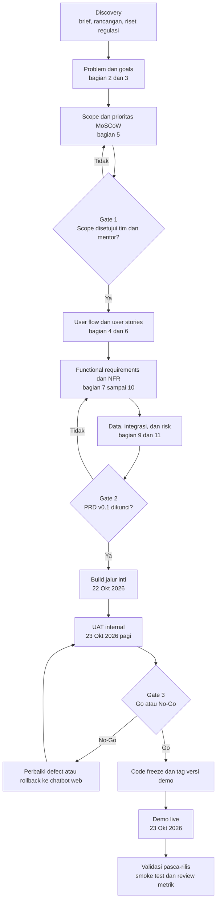

### 18.2 User flow utama

Alur pemilik usaha dari pesan pertama sampai paket persiapan. Percabangan error mencakup penolakan persetujuan, foto tidak terbaca, bukti daging atau unggas kurang, pemasok tidak ditemukan, dan permintaan pengguna agar agen menyatakan kepastian halal.

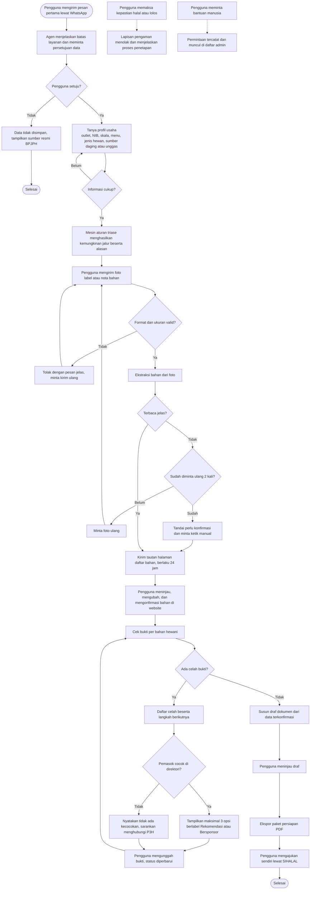

### 18.3 Sequence diagram

Interaksi pengguna, WhatsApp, inti agen, penyimpanan, website, dan model bahasa untuk perjalanan inti (ekstraksi bahan, cek bukti, rekomendasi pemasok, ekspor). Penghapusan dan pengajuan SIHALAL dikerjakan pengguna sendiri.

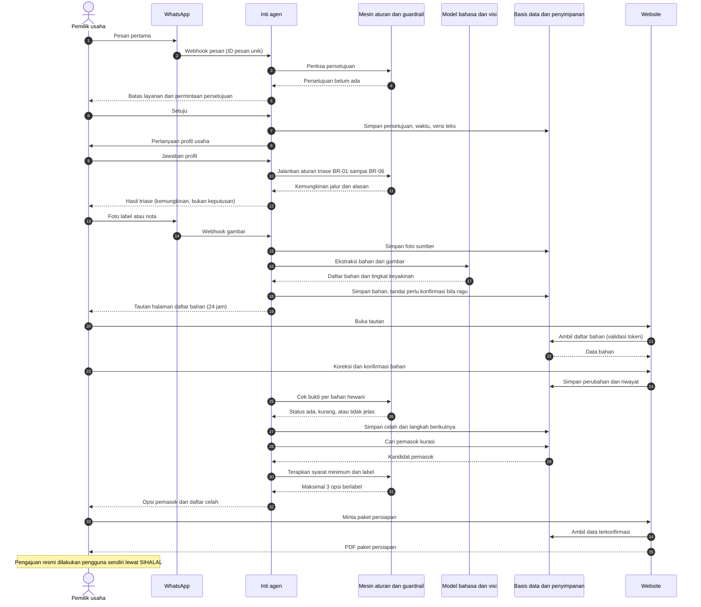

### 18.4 State diagram

Siklus status sebuah kasus persiapan dari pesan pertama sampai paket diekspor. Kasus yang tidak aktif ditutup, dan permintaan penghapusan data dapat diajukan dari status mana pun.

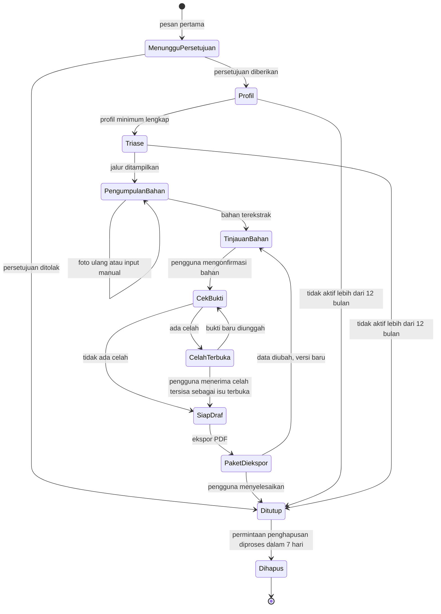

### 18.5 Arsitektur tingkat tinggi dan ERD

Satu inti agen melayani dua kanal sehingga demo tetap berjalan bila WhatsApp bermasalah (NFR-006). Data kedua kanal berada di penyimpanan yang sama.

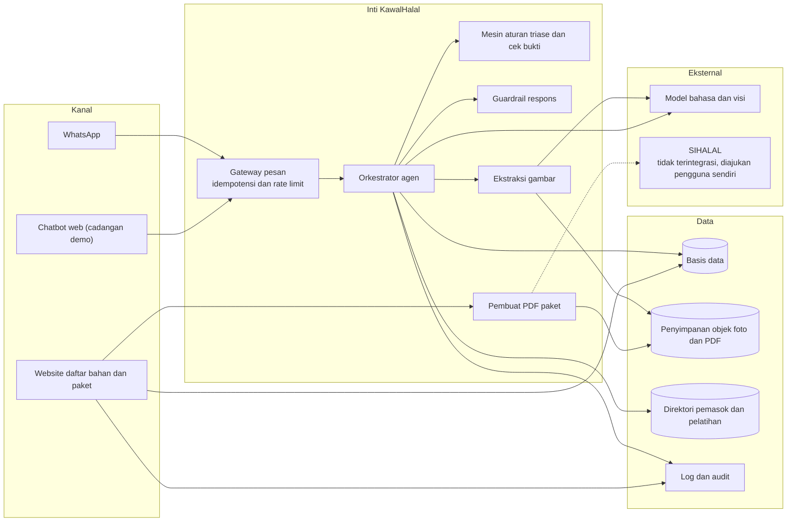

ERD berikut mengikuti entitas pada bagian 9.

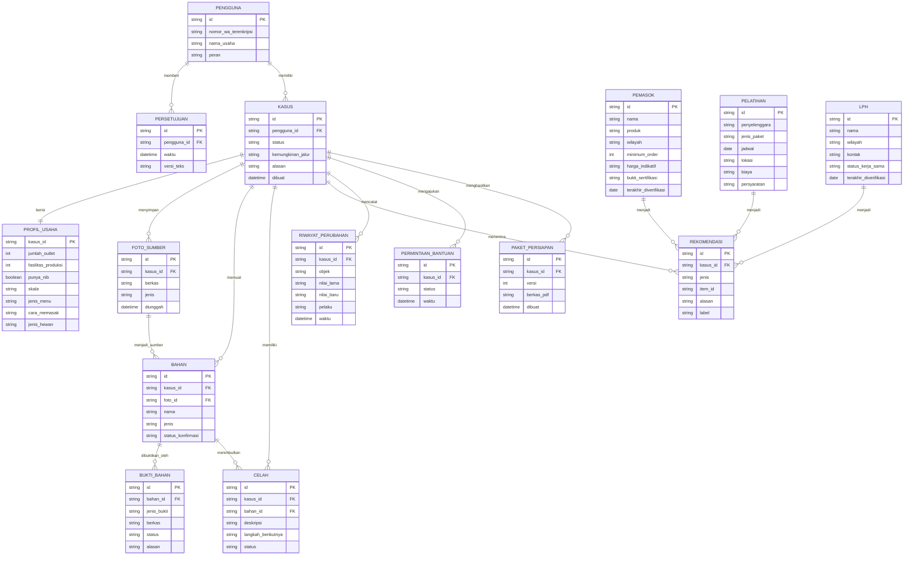

### 18.6 UAT workflow

Alur UAT dari persiapan sampai keputusan Go atau No-Go, dengan loop defect sesuai definisi severity pada bagian 15.

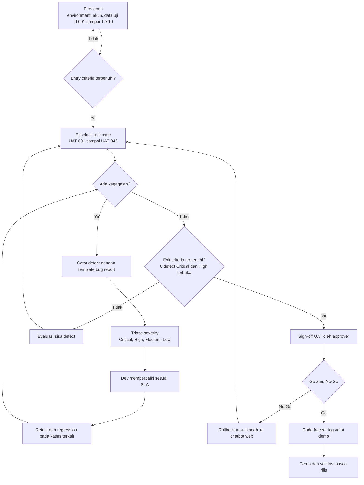

### 18.7 Timeline rilis

Timeline mengikuti release plan pada bagian 11. Jam bersifat [ASUMSI] dan disesuaikan dengan jadwal panitia.

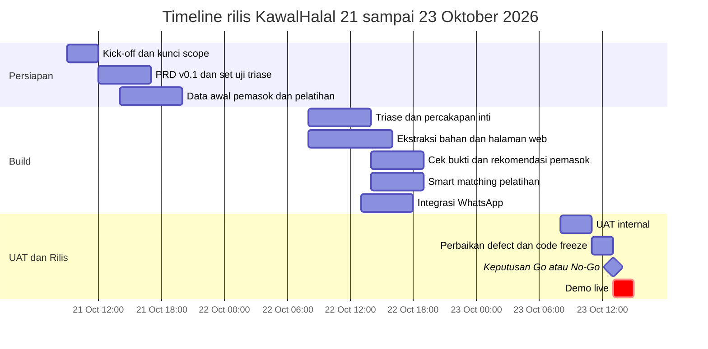

### 18.8 Alur sertifikasi halal self-declare (proses resmi)

Diagram ini mengikuti infografis resmi alur self-declare yang diberikan tim. KawalHalal hanya membantu tahap persiapan, yaitu triase jalur, daftar bahan, celah bukti, dan draf dokumen dari data yang dikonfirmasi pengguna, sampai paket siap diajukan. Pendaftaran di SIHALAL dilakukan UMKM sendiri. Verifikasi pendamping, verifikasi dokumen BPJPH, penerbitan STTD, sidang fatwa, dan penerbitan sertifikat dilakukan pihak resmi. Pada alur ini tidak ada tahap invoice biaya pemeriksaan LPH (BR-17). Tahap perlu diverifikasi ulang ke BPJPH sebelum dijadikan konten panduan di produk.

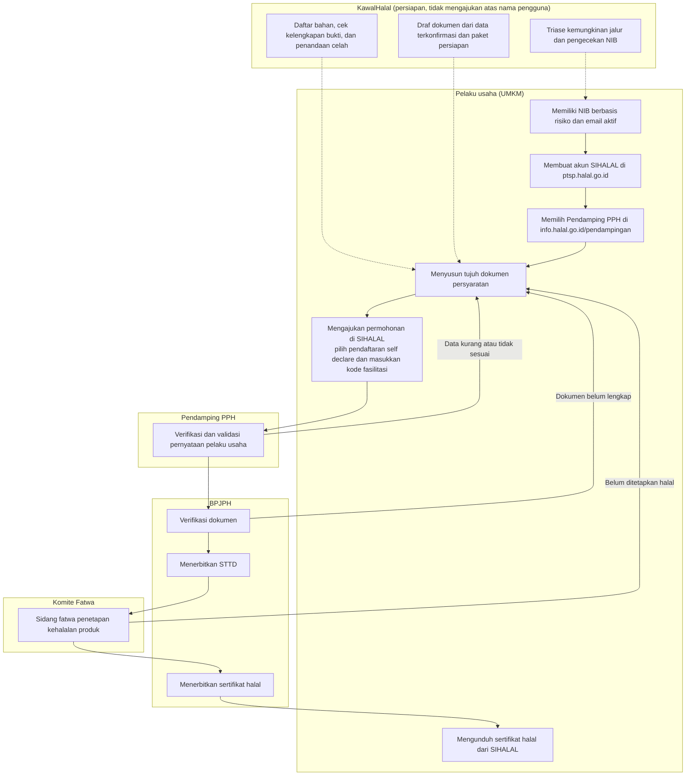

### 18.9 Alur sertifikasi halal reguler (proses resmi)

Diagram ini mengikuti infografis resmi alur reguler yang diberikan tim. Perbedaan utamanya dari self-declare adalah pemeriksaan oleh LPH dan adanya biaya pemeriksaan yang dihitung LPH, dibayar pelaku usaha lewat virtual account, dan menjadi syarat terbitnya STTD. Bantuan KawalHalal sama seperti pada self-declare, ditambah penjelasan tahap biaya dan, untuk bahan hewan sembelihan, hubungan ke LPH (US-013).

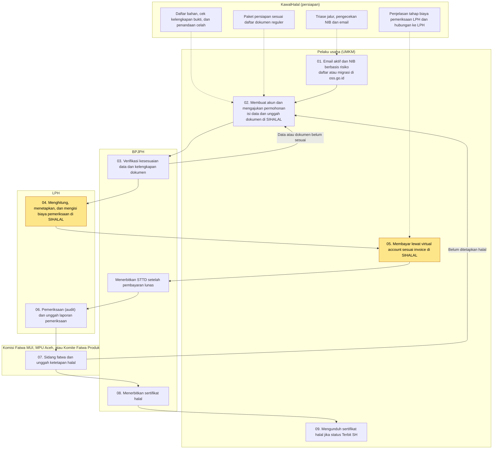

Perbandingan kedua jalur.

| Aspek | Self-declare | Reguler |
| --- | --- | --- |
| Pihak yang memverifikasi | Pendamping PPH, lalu verifikasi dokumen BPJPH | BPJPH memeriksa kelengkapan, lalu LPH melakukan pemeriksaan (audit) |
| Biaya pemeriksaan | Tidak ada tahap invoice pemeriksaan LPH pada alur resmi yang dipakai tim [ASUMSI, biaya lain seperti jasa pendampingan perlu dicek] | Ada. LPH menetapkan biaya di SIHALAL, pelaku usaha membayar lewat virtual account, dan STTD terbit setelah lunas |
| Kapan STTD terbit | Setelah verifikasi dokumen BPJPH | Setelah pembayaran lunas |
| Sidang fatwa | MUI | Komisi Fatwa MUI, MPU Aceh, atau Komite Fatwa Produk Halal |
| Kelayakan | Usaha yang memenuhi kriteria (misalnya 15 kriteria SEHATI 2026) | Usaha yang tidak memenuhi kriteria self-declare |
| Dokumen khas | Ikrar pernyataan halal pelaku usaha | Formulir pendaftaran, termasuk 2 juru sembelih halal untuk jasa penyembelihan |

Tujuh dokumen persyaratan jalur self-declare dan dukungan KawalHalal pada MVP.

| No | Dokumen | Dukungan KawalHalal |
| --- | --- | --- |
| 1 | Surat permohonan | Draf dari data terkonfirmasi (FR-019) |
| 2 | Aspek legal (NIB) | Pengecekan NIB pada triase (BR-02), dokumen NIB diunggah pengguna |
| 3 | Dokumen penyelia halal | Draf bila datanya diberikan pengguna, penetapan penyelia tetap oleh usaha |
| 4 | Daftar produk dan bahan yang digunakan | Inti MVP, dari ekstraksi foto dan konfirmasi pengguna (FR-006, FR-009) |
| 5 | Proses pengolahan produk | Draf dari jawaban profil dan cara memasak (FR-003, FR-019) |
| 6 | Manual Sistem Jaminan Produk Halal (SJPH) | Di luar MVP, [REKOMENDASI] fase 2 dengan template yang disepakati pendamping |
| 7 | Ikrar pernyataan halal pelaku usaha | Draf teks tanpa tanda tangan, pengguna menandatangani sendiri |

Tujuh dokumen persyaratan jalur reguler dan dukungan KawalHalal pada MVP. Format templat dapat diunduh dari bpjph.halal.go.id/detail/informasi-1.

| No | Dokumen | Keterangan resmi | Dukungan KawalHalal |
| --- | --- | --- | --- |
| 1 | Surat permohonan | Pelaku usaha luar negeri memakai surat dari importir atau perwakilan resmi dengan surat kuasa | Draf dari data terkonfirmasi (FR-019) |
| 2 | Formulir pendaftaran | Jasa penyembelihan wajib memiliki 2 juru sembelih halal bersertifikat pelatihan berbasis SKKNI dan atau sertifikat kompetensi | Draf dan pengingat kebutuhan 2 juleha, terhubung ke smart matching pelatihan (US-009) |
| 3 | Aspek legal | NIB berbasis risiko, pelaku usaha luar negeri memakai lisensi bisnis dan NIB importir atau perwakilan | Pengecekan NIB (BR-02) |
| 4 | Dokumen penyelia halal | SK penetapan penyelia halal, kartu identitas, daftar riwayat hidup, sertifikat pelatihan atau kompetensi penyelia (atau keduanya untuk usaha menengah, besar, dan luar negeri) | Daftar periksa dan draf bila data diberikan, dokumen identitas tidak disimpan di MVP (EC-08) |
| 5 | Daftar nama produk, bahan, dan menu | Format templat BPJPH | Inti MVP, dari ekstraksi foto dan konfirmasi pengguna |
| 6 | Proses pengolahan produk | Diagram alur atau deskripsi proses produksi | Draf dari jawaban profil dan cara memasak |
| 7 | Manual SJPH | Format templat BPJPH | Di luar MVP, [REKOMENDASI] fase 2 |

### 18.10 Alur smart matching pelatihan penyembelihan halal

Alur epic E3 sebagai bagian MVP. Langkah penalaran agen ditandai dalam diagram, yaitu bertanya dulu sebelum menyaring, meranking dengan alasan, dan menawarkan pelonggaran hanya dengan persetujuan pengguna.

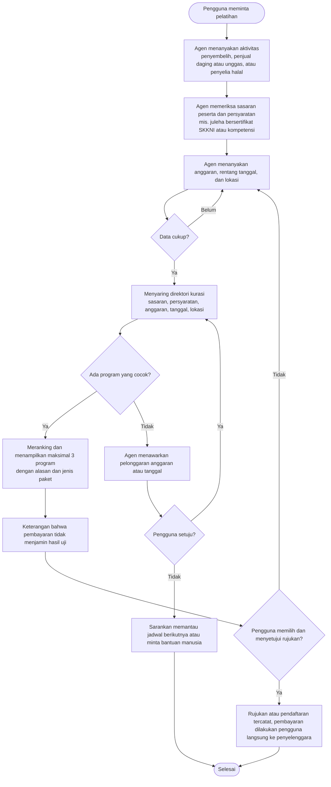
